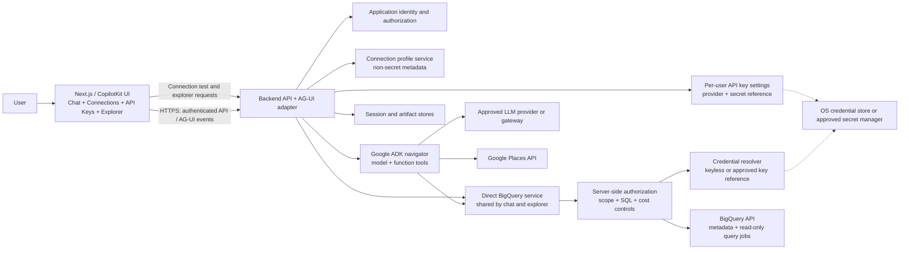

# Data Navigator Standalone: High-Level Architecture Proposal

**Status:** Feasibility assessment and proposed design; not implemented.  
**Date:** 2026-11-14  
**Target:** A new repository with an AG-UI application and Google ADK agent
that connects directly to BigQuery, without a BigQuery MCP server.

## 1. Executive summary

**Feasible.** ADK can expose application-owned Python functions as tools, and
the Google Cloud BigQuery client can authenticate with a service-account
identity or Application Default Credentials (ADC). The new backend can
therefore issue BigQuery metadata requests and read-only query jobs directly.
Neither ADK nor AG-UI requires an MCP server for those operations.

The proposed product retains the familiar **DBeaver-style connection setup**:
project, additional projects, authentication method, credential selection,
and **Test connection**. It does **not** copy DBeaver's implementation or
require a JDBC driver. In a web application, a browser's local file path is
not automatically accessible to a backend container or remote server; the
credential flow must explicitly account for that distinction.

Each user also configures their **own LLM API key through the web app**:
either a LiteLLM gateway key or a Google model API key. A separate Google
Places key is configured when that user wants Places features. Keys are
independently owned and managed; the backend must never silently use another
user's or a shared application key.

**Recommended direction:** Start with a local, single-user pilot and direct
ADK function tools. For shared hosting, require authenticated users, approved
identity delegation or securely managed connection credentials, and
server-enforced data and cost policies. Prefer keyless identities where
possible; support service-account JSON only where organizational policy permits.

This is a new-repository design proposal, not a deployment decision. It does
not assert that direct access, a particular auth method, or shared multi-user
isolation already exists or is approved.

## 2. Current baseline and migration implications

The existing local UI combines Next.js/CopilotKit, an AG-UI bridge, an ADK
agent, BigQuery MCP, and session/artifact infrastructure. The
[UI development plan](./google_ag_ui_adk_dev_plan.md) describes the current
local prototype and outstanding production gates. The current
[backend Dockerfile](../Dockerfile.backend) explicitly describes itself as a
compatibility spike, not a production-hardened image.

BigQuery currently has **two MCP-dependent surfaces**:

1. Agent tool discovery and chat query execution.
2. The BigQuery explorer's schema and column-index endpoints in
   [ag_ui_server.py](../src/cotality/agent/ag_ui_server.py), which directly
   invoke MCP independently of the model.

Replacing only the agent's toolset would leave the explorer dependent on MCP.
The new repository must route **both** through the same direct BigQuery service
and authorization policy. Existing prompts and skill instructions that name
MCP tools also need compatible tool names or explicit updates.

An existing [benchmark sampler](../src/cotality/agent/benchmark/sampler.py)
creates a direct BigQuery client, showing a possible SDK interaction, but it
is not an interactive, policy-enforced chat backend and must not be copied as
a security boundary. Existing MCP guards and tool contracts should be reviewed
for parity, not assumed to transfer automatically.

## 3. Goals and non-goals

### Goals

- Run the web UI, ADK backend, and direct BigQuery client **without a BigQuery
  MCP process**.
- Let a user configure and test a BigQuery connection in a familiar UI.
- Let each user configure, test, replace, and remove their own LLM API key
  and optional Google Places API key in the web UI.
- Support approved service-account JSON for the local pilot and a keyless
  identity path for suitable environments.
- Browse approved projects, datasets, tables/views, and columns; answer chat
  questions and run controlled read-only queries.
- Keep streaming, session history, error/provenance display, charts and CSV
  artifacts where approved and verified.
- Enforce policy in deterministic backend code and BigQuery IAM, not in
  model instructions or browser controls.

### Non-goals for the first pilot

- A production-ready multi-tenant credential vault or unrestricted arbitrary SQL.
- Editing BigQuery data, DDL, DML, scripts, export jobs, external connections,
  remote functions, or unrestricted stored procedures.
- Automatic per-user Google authorization just because the app has SSO.
- Assuming Collibra, skill marketplace, existing MCP integrations, or every
  current UI feature is automatically migrated.

## 4. Proposed logical architecture



**Trust boundaries:** Browser input, LLM output, uploaded files, and catalog
text are untrusted. Neither UI selection nor a tool call produced by the model
grants access. The backend resolves a connection against the authenticated
principal and evaluates server-owned policy before constructing a BigQuery
request. BigQuery IAM is an independent final authorization layer.

The BigQuery client belongs in the backend process, not in the browser or
model context. AG-UI carries chat/progress events; ordinary authenticated API
endpoints handle connection configuration and metadata browsing without an
LLM call.

LLM and Places calls resolve the authenticated user's own provider-specific
secret on the backend at the point of use; the diagram does not imply the
model itself can read credentials. BigQuery authentication remains a separate
connection identity.

## 5. DBeaver-style connection experience

### Proposed form

| Field | Purpose and constraints |
|---|---|
| Connection name | User-friendly label; not a credential. |
| Job / billing project | Project in which BigQuery query jobs are created and billed; separately authorized. |
| Data project(s) | Explicit allowlist of approved projects to browse/query; additional projects do not grant access. |
| Dataset/object scope | Admin-approved dataset/table/view policy, intersected with the selected connection and IAM. |
| Location | Dataset/job location or an explicit auto-detection policy; reject incompatible locations. |
| Authentication | Local pilot: approved JSON key or ADC. Hosted: approved attached identity, federation/impersonation, or centrally managed secret reference. |
| Credential selection | Local file chooser or secure secret reference, according to deployment mode below. Never put key contents in chat. |
| Test connection | Explicit, bounded checks with clear identity, project, location, and permission results. |

Use the standard Google BigQuery API endpoint and HTTPS by default; do not make
arbitrary host/port overrides a normal user option. Proxy, private endpoints,
and alternate endpoints require an administrator-approved configuration and
network policy. The screenshot's path, project identifiers, and key details
are not included in this proposal.

### User workflow

1. Open **Connections → New BigQuery connection**; provide profile and
   approved project scope.
2. Choose an allowed authentication method and credential source.
3. Select **Test connection**. Report separately:
   - Credential parsing/refresh and authenticated identity, if established.
   - Access to the selected project's permitted metadata.
   - Job creation and query capability **only if actually tested**.
4. Save the profile only after required validation; show its owner, scope,
   authentication method, and last-test status without exposing secrets.
5. Select the connection for a chat or explorer. Show connection, project and
   location in the UI and in query provenance; require an explicit switch.

Metadata access does not prove a query will succeed. A dry run may help
validate query syntax, access, and estimated bytes where supported, but does
not by itself prove a job was executed or that returned data is accessible.
If job-creation permission must be verified, offer a separately explained,
bounded test query; run it only with user authorization and report actual
success/failure and any cost implications.

### Credential handling by deployment mode

| Mode | Recommended design | Important limitation |
|---|---|---|
| Local single-user | Prefer local ADC or service-account impersonation. If approved, select a JSON file in a local companion/backend process or upload once through a local-only, protected API. | A browser cannot send a usable local path to a container automatically. A file chooser normally supplies file bytes, not a server filesystem path. |
| Local Docker | Use ADC/impersonation available to the backend or explicitly mount an approved file read-only at a fixed container path; a user may select a logical credential profile. | Host and container paths differ. Never accept arbitrary backend paths or mount a user's home directory. |
| Shared hosted | Prefer a workload identity, impersonation, or approved enterprise secrets manager with tenant-scoped references. | A local DBeaver key path is unavailable to the remote backend. Per-user service-account uploads are **not enabled by default**. |
| Hosted JSON, if explicitly approved | Upload only through an authenticated, TLS-protected connection endpoint; validate and write directly to an approved secret manager with scoped access, audit, rotation and deletion. | Higher-risk exception requiring security, privacy, and operations approval; never store the key in sessions, artifacts, DB profile rows, logs, or the model prompt. |

Do not treat user-provided JSON as a general credential-configuration file.
If JSON keys are permitted, accept only the explicitly supported service-account
key format, validate expected identity/project and fixed trusted Google
authentication endpoints, enforce file/type/size limits, and reject
unexpected fields or external credential-source URLs as appropriate. Do not
permit arbitrary credential-provided token endpoints, executable credential
sources, local paths, or URLs. The security team must review the exact schema
and supported Google authentication-library behavior before implementation.
Do not log uploaded bytes, private keys, tokens, or authorization headers.

The screenshot shows a **long-lived service-account key**. Google recommends
avoiding such keys where possible: possession of the private key permits
acting as that account. If approved, require narrow IAM permissions, lifecycle
ownership, rotation/revocation, and incident response. Avoid sharing a key
among users and never bake one into a Docker image, source repository, or
client-side bundle.

### User API keys for the agent

The web app provides a separate **Settings → API Keys** page; these credentials
are distinct from the BigQuery service-account connection.

| Setting | Requirement | Use |
|---|---|---|
| LLM provider | Each user selects an approved provider and model alias. | The backend selects the corresponding adapter; provider endpoints and permitted models are administrator-configured, not arbitrary user URLs. |
| `LITELLM_API_KEY` | Required for a user selecting the approved LiteLLM gateway. | Authenticates that user's calls to the approved gateway. |
| `GOOGLE_API_KEY` | Alternative required for a user selecting an approved Google model endpoint. | Authenticates that user's Google model calls. |
| `GOOGLE_PLACES_API_KEY` | Optional for general use; required for that user's Places-dependent features. | Authenticates Places calls; it is a separate credential and is not interchangeable with the selected LLM key. |

These are familiar credential **types**, not process-wide environment
variables shared among users. A user needs one valid, independently managed
LLM credential for LLM-backed chat. Metadata browsing and connection setup
that do not require a model can remain available without one. A missing or
invalid Places key disables or rejects only Places-dependent operations with
an actionable message; it must not block unrelated BigQuery browsing or chat.

**Proposed flow:**

1. The authenticated user chooses LiteLLM or Google and an approved model.
2. They enter their own key in a masked input and explicitly save it. A
   separate optional field accepts their Google Places key.
3. The backend accepts each key through a dedicated authenticated TLS API,
   applies input-size and request protections, and stores it in an approved
   secret store under a user- and provider-scoped reference. The settings
   database stores only non-secret references and status metadata.
4. The UI shows configured/not configured, provider, optional approved masked
   identifier, and last-test status; it never re-displays the full key.
   Users can explicitly **test, replace, or delete** each key. Replacement
   and deletion invalidate dependent caches and in-flight credential leases.
5. Before each LLM or Places operation, the backend resolves the current
   authenticated user and authorized secret reference. An absent, revoked,
   invalid, or inaccessible key fails explicitly: **no fallback to a shared
   or another user's key**. A provider selection change cannot reuse a key
   from the wrong provider.

Testing a key may call a billable external API. Use a provider-approved,
bounded test where available, tell the user what will be tested and any
potential cost, require an explicit action, rate-limit it, and display the
actual result without logging or echoing the key. A successful authentication
test does not guarantee every model, quota, billing account or Places
operation is authorized.

For the local single-user pilot, use an approved local secret mechanism or an
explicitly documented session-only option; do not save keys in browser
storage or plaintext app configuration. Shared deployment requires
enterprise SSO, tenant/user-scoped secret-store authorization and operational
approval before enabling per-user keys. The backend must enforce ownership,
including on key test, replacement, deletion, agent delegation, retries and
concurrent requests. Never accept a user ID, secret reference, credential
header, or provider URL from an LLM tool argument as authority.

Credentials must never appear in chat, LLM prompts or tool outputs, session
state, artifacts, URLs, logs, traces, exceptions, analytics, screenshots or
client-side persistent storage. They are transmitted only to the backend
and, as required for authentication, to the **approved provider** over TLS.
Redact upstream errors and request headers. Keep secrets server-side, encrypt
them at rest, restrict access, audit non-secret lifecycle events, and define
rotation, revocation, retention and deletion. The application cannot prove
that two differently configured users truly own different provider accounts
merely by accepting key strings; independent issuance and billing ownership
must be established through the provider and organizational policy.

## 6. Backend design

### 6.1 Connection and identity

- A connection profile stores non-secret metadata and a credential **reference**.
- Resolve credentials on the server for each authorized operation; never rely
  on a process-global `GOOGLE_APPLICATION_CREDENTIALS` change to select among
  concurrent users. Construct clients using the connection's explicitly
  resolved credentials and job project.
- Bind connection ownership/sharing and selected connection to an authenticated
  principal and session. A connection ID supplied by the UI or model is not
  authorization. Validate every lookup, test, query, export and artifact read.
- Scope caches and client reuse by identity, connection, credential version,
  project, location and policy version; invalidate on rotation, permission or
  scope changes. Never share results across principals by default.
- Application SSO and BigQuery credentials are separate identities. Unless an
  approved delegation design is implemented, BigQuery audit logs identify the
  service account; application audit records must additionally attribute the
  initiating user without logging private data.
- Resolve LLM and Places credentials by authenticated user and provider on
  each request; keep BigQuery connection credentials separate. Pass resolved
  credentials to request-scoped clients, not global environment mutations,
  shared singleton state, user-visible session state, or model/tool text.
  Ensure delegated agents and asynchronous work inherit verified user context,
  never a model-selected user ID. Include credential version and principal in
  caches or client pools, and invalidate them on replacement or deletion.

### 6.2 Direct BigQuery service and ADK tools

Define one backend service used by **both** ADK function tools and explorer
endpoints:

| Proposed operation | Behavior |
|---|---|
| `test_connection` | Explicit auth/metadata checks and optional separately approved query test. |
| `list_datasets`, `list_tables`, `get_schema` | Return only authorized, policy-approved objects; pagination and errors are explicit. |
| `get_freshness_metadata` | Return supported object metadata with provenance; do not equate modification timestamps with confirmed pipeline refresh. |
| `estimate_query` | Validate policy, dry-run an approved query, and return estimated bytes plus limitations. |
| `run_read_query` | Revalidate policy, use the selected connection, submit a bounded job, and return a paginated/limited result with provenance. |

Names and result schemas above are proposed, not existing APIs. Preserve or
adapt current skill/tool contracts, continuation shapes, and error semantics;
do not silently remove capabilities. Let ADK invoke typed tools; keep policy
enforcement inside the shared service, so an explorer endpoint cannot bypass
checks by avoiding the agent.

Use the official BigQuery Python client. It is synchronous: isolate blocking
calls from the async API/event loop with a bounded worker pool and connection,
request, concurrency, deadline, and cancellation controls. A user cancel or
timeout must attempt to cancel the BigQuery job where supported and report
the actual job state; do not claim cancellation until confirmed.

### 6.3 Query safety and cost

- Default deny. Apply approved project/dataset/object scope independently of
  user-provided SQL, profile metadata, and model-generated tool arguments.
- Use a BigQuery-aware parser/validator plus server-side BigQuery checks;
  enforce a single approved read-only statement. Explicitly handle or reject
  scripts, DDL/DML, `EXECUTE IMMEDIATE`, external tables/connections, remote
  functions, routines, wildcard tables, views, and ambiguous references.
  Fail closed on unsupported or unresolvable constructs. IAM must remain
  least-privilege even if a parser is incomplete.
- Resolve fully qualified projects and table identities; account for approved
  views and their underlying access behavior. Define whether approved views
  may reference other resources and test that policy explicitly.
- Use typed query parameters for values; validate identifiers separately
  because query parameters cannot substitute arbitrary SQL identifiers.
- Dry-run first where applicable; enforce per-job `maximum_bytes_billed`,
  job-project quotas, output/result limits, timeouts, and concurrency limits.
  Confirm cost semantics for the chosen pricing model. **A row limit does not
  cap scanned bytes**, and capacity pricing is not equivalent to per-byte cost.
- If an estimate is unavailable or exceeds policy, stop explicitly. Where a
  larger query is permitted, require an authenticated approval bound to the
  exact query, connection, scope, estimate and expiry; revalidate before use.
- Return job ID, connection label, project/location, source scope, estimated
  and actual bytes when available, result completeness and errors. Avoid
  logging SQL literals, credentials, or raw result rows by default.
- Restrict which BigQuery results may be sent to the approved model gateway;
  apply data classification, masking/redaction and egress policy before
  model input, logs, browser display, downloads, or artifacts.

## 7. Storage, security and operations

| Concern | Local pilot | Shared deployment gate |
|---|---|---|
| User identity | Explicitly single-user, bound to localhost; no claim of isolation | Enterprise SSO and server-verified identity on all API, AG-UI and artifact routes |
| Credentials | Approved ADC/impersonation or explicitly allowed local key | Approved workload identity/secret manager; lifecycle, authorization and audit |
| User API keys | User supplies their own LLM key; Places key optional | User/provider-scoped secret store, SSO authorization and no shared-key fallback |
| Profiles | Local metadata store; no key contents | Per-user/tenant authorization, ownership and administrative controls |
| Sessions/artifacts | Local storage with documented retention | Durable, scoped storage, encryption, quotas, deletion and retention policies |
| Network | Local-only listener; Google API access | Approved ingress/egress, TLS, endpoint allowlist, timeouts and rate limits |
| Audit | Redacted local events | User + connection + job attribution; no secrets or unapproved data in logs |
| Supply chain | Pinned dependencies and compatible versions | Image hardening, non-root runtime, scanning, patching and platform approval |

Connection tests, explorer searches and query access must enforce identical
authorization. Protect credential uploads from CSRF, enforce request size
limits and safe errors, and prevent secrets from appearing in traces or crash
reports. Metadata and results are also potentially sensitive.

**Accessibility:** Build the connection form with semantic HTML, labels,
keyboard-operable controls and dialogs, appropriate ARIA where needed,
adequate contrast, and accessible status/error messages. Verify WCAG 2.1 AA
with automated checks such as axe/Lighthouse plus manual keyboard and
screen-reader testing.

## 8. Proposed repository and rollout

Illustrative structure, subject to team conventions and approved dependency
versions:

```text
data-navigator-standalone/
  frontend/                  # Next.js, CopilotKit, connection/explorer UI
  backend/
    agent/                   # ADK agent, prompts, typed function tools
    connections/             # profiles, identity and credential resolution
    credentials/             # per-user LLM and Places key references and resolution
    bigquery/                # shared service, query policy and validation
    api/                     # AG-UI and authenticated connection/explorer routes
    tests/                   # policy, isolation, integration and agent tests
  docs/
  compose.yaml               # local-only setup; no MCP dependency
```

1. **Architecture and security decisions:** Choose local vs hosted scope,
   credential/key policy, identity mapping, project and dataset approval,
   budget limits, target platform, and new-repository ownership. Obtain
   security and data-owner review.
2. **Compatibility spike:** Pin and test an approved ADK/AG-UI/CopilotKit
   combination and BigQuery client. Validate direct access using a test
   identity and non-sensitive data; do not assume installed versions in this
   repository are the versions selected for the new one.
3. **Connection pilot:** Implement local profile creation, credential
   selection and explicitly scoped connection tests; demonstrate deletion and
   redacted errors without storing key material in chat/session artifacts.
   Add per-user LLM and optional Places key settings, secure storage, explicit
   paid-test consent, and fail-closed provider resolution.
4. **Shared direct backend:** Implement policy-enforced metadata, cost
   estimation, and read-only query operations. Connect **both** ADK tools and
   explorer endpoints; retain pagination and tool-result contracts.
5. **UI and regression parity:** Add connection picker, explorer, provenance,
   chat, cancellation, charts/exports, and error display. Decide which
   existing skills and Collibra capabilities are migrated or deferred.
6. **Hardening and release:** Implement approved SSO and credential lifecycle,
   production storage, quotas, monitoring, accessibility, threat review,
   load testing, deployment runbook and rollback. Release only after gates
   below pass.

No separate MCP server is needed in any phase; a backend API/AG-UI adapter,
BigQuery service, and external Google API are still required.

## 9. Acceptance criteria and open decisions

### Minimum pilot acceptance

- [ ] Fresh local deployment runs chat and BigQuery explorer with **no MCP
  server process or `MCP_SERVER_URL` dependency**.
- [ ] User can create, test, select, update and remove a connection; browser
  and container credential behavior is explained and tested.
- [ ] Each user can select an approved LLM provider and securely configure,
  test, replace and delete their own provider key in the web app. LLM-backed
  chat fails explicitly without that user's selected key; there is no
  shared-key fallback.
- [ ] Each user can separately configure, test, replace and delete a Places
  key. Without one, Places-dependent operations fail explicitly while
  unrelated chat and BigQuery operations remain available.
- [ ] Concurrent-user and delegated-agent tests prove requests use only the
  authenticated user's provider-specific credentials; missing, revoked,
  deleted, rotated, and wrong-provider keys cannot fall back to another user.
- [ ] Tests verify key lifecycle authorization, masked display, redaction,
  secret-store failures, cache invalidation, and explicit consent for
  potentially billable test calls.
- [ ] Metadata, query, chat and explorer use the same selected connection and
  fail closed for off-policy projects, datasets, tables, and SQL constructs.
- [ ] IAM denial, invalid credentials, wrong location, unavailable project,
  excessive estimate, timeout, cancellation and partial pages are explicit.
- [ ] Connection test distinguishes authentication, metadata permissions,
  dry-run checks and an actual query job; no false success claims.
- [ ] Tool results show scope, completeness and provenance; query output and
  model-bound content meet approved data-handling rules.
- [ ] No credential appears in source, image layers, session history,
  artifacts, model requests, normal logs or client storage.
- [ ] Fixture-based tests prove isolation, policy enforcement, SQL rejection,
  cost controls, pagination, cancellation and secret redaction. An approved
  live test checks real IAM and queries against non-sensitive pilot resources.
- [ ] User can operate the connection flow by keyboard and assistive
  technology; automated accessibility checks pass.

### Decisions required before build

- Is the first release **local single-user**, shared hosted, or both?
- May users upload service-account JSON, or must keys remain admin-managed?
  Which organization policies, key expiry and secret store apply?
- Which LLM providers, model aliases and Places API restrictions are approved?
  Which user-scoped secret store and local session-only policy are available?
- How are individual provider-account ownership, quotas, spending limits,
  key rotation, deletion and incident response governed?
- Are connections private to each user or administratively shared? Who may
  select, test, modify, rotate and delete them?
- Which projects, datasets, tables/views and locations are approved? How do
  policy changes and authorized views interact with IAM?
- What query-byte, concurrency, output, timeout and model-egress limits are
  required, and who approves exceptions?
- Is per-user Google identity/impersonation required, or is application-level
  attribution against a shared service identity acceptable?
- Which existing UI, skills, artifacts and Collibra functions are in scope?

## 10. References

- [Google ADK function tools](https://adk.dev/tools-custom/function-tools/)
- [BigQuery authentication and Application Default Credentials](https://docs.cloud.google.com/bigquery/docs/authentication)
- [Google service-account key management guidance](https://docs.cloud.google.com/iam/docs/best-practices-for-managing-service-account-keys)
- [BigQuery IAM roles and permissions](https://docs.cloud.google.com/bigquery/docs/access-control)
- [BigQuery cost estimation and controls](https://docs.cloud.google.com/bigquery/docs/best-practices-costs)
- [Current UI development plan](./google_ag_ui_adk_dev_plan.md)
- [Current Data Navigator architecture](./sdap_data_navigator_architcure.md)
