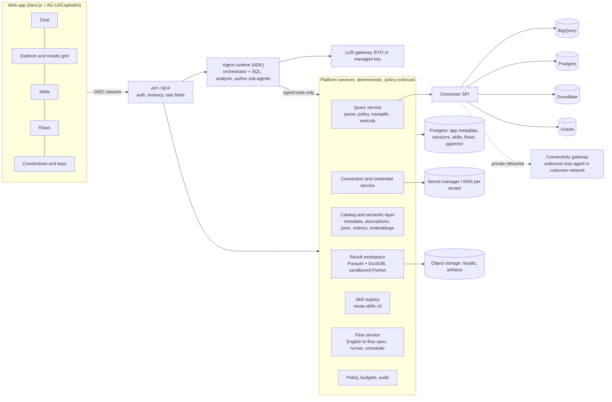

# One Data Navigator: Architecture Evaluation and Proposal

**Status:** Proposal for review; not implemented.  
**Date:** 2026-11-14  
**Builds on:** [Data_Navigator_Standalone_Arch.md](./Data_Navigator_Standalone_Arch.md)

## Product vision

A web app that lets anyone connect to different databases (BigQuery first, then
Postgres, Snowflake, Oracle and more), like DBeaver, but with an agentic experience:

1. Cloud-based web experience: nothing to download or install.
2. Talk to and query databases in plain English.
3. Most querying and data analysis happens in the chat.
4. Users build skills and define data flows in plain English; the agent does the data work.

## 1. Evaluation of the Standalone architecture

| Goal | Coverage | Gap |
|---|---|---|
| 1. Cloud web app, no install | Partial | Local single-user pilot first; hosted mode is listed as a later "gate". Nothing on reaching databases inside customer networks (on-prem Oracle, private Postgres), which DBeaver gets for free by running on the user's machine. |
| 2. Query in plain English | Good for BigQuery | Built around one engine (`bigquery/` service, BigQuery-only tool names). No connector abstraction, SQL dialect handling, or shared catalog. No context layer (descriptions, joins, metrics), which is what makes plain-English questions accurate. |
| 3. Analytics done in chat | Weak | Covers running read queries. No result workspace (follow-up questions on a result without re-querying), no analysis engine, and no handling of large results beyond row limits. |
| 4. Skills and data flows in plain English | Missing | Skills and Collibra are "may be deferred". Data flows aren't mentioned. This is the main differentiator against DBeaver. |

**Keep from the Standalone doc:**

- One shared service for chat and explorer.
- Policy enforced in backend code, not prompts.
- Per-user credentials with no shared-key fallback.
- Dry run, byte caps and job cancellation.
- No MCP in the core path.
- Clear trust boundaries.

**Change:**

- Make it cloud-first and multi-tenant from day one.
- Use a pluggable connector layer instead of a BigQuery service.
- Add four missing parts: a context (semantic) layer, a result workspace, flows, and a
  gateway for private networks.

## 2. Proposed architecture

### Key design choices

1. **Connector SPI, one interface per database.**
   - Every connector supports: `test`, `list_catalog`, `get_schema`, `estimate`,
     `execute(paged)`, `cancel`, plus a declared list of capabilities and SQL dialect.
   - Order: BigQuery first, then Postgres, which proves the abstraction is right, then
     Snowflake and Oracle.
   - Use `python-oracledb` in thin mode, which needs no Oracle client install.
2. **One query path for everything.** Explorer, chat, skills and flows all go: parse
   with sqlglot (it handles all four dialects), then read-only and scope policy, then
   transpile to the target dialect, then estimate and enforce the budget, then run.
   - This generalises today's allowlist validator and replaces the regex parsing.
   - The model never calls a database directly.
3. **Results stay out of the prompt.**
   - Query results are written to Parquet in a per-session workspace.
   - The model gets a schema, row count and sample.
   - Follow-up questions ("now group by state", "chart it") run in DuckDB over that
     Parquet, with no re-query and no cost.
   - Python analysis runs in a sandbox job such as Cloud Run with gVisor.
   - This keeps tokens, cost and data leaving the platform small.
4. **Context (semantic) layer per connection.**
   - A crawler collects table and column metadata.
   - Descriptions come from the database, Collibra, or are AI-suggested and labelled as such.
   - Approved joins and metric definitions are stored in Postgres with pgvector embeddings.
   - The agent pulls only the relevant tables into context; this is the biggest lever on
     plain-English query accuracy.
5. **Skills and flows are two separate things.**
   - **Skills:** reviewed procedures the agent follows, built on the skills v2 registry,
     quality checks and UI already in Smart Data Navigator.
   - **Flows:** the user describes a pipeline in English; the agent drafts a declarative
     flow spec (versioned YAML: sources, SQL/DuckDB steps, outputs, schedule).
   - The user previews and dry-runs the flow, then an admin approves it.
   - A deterministic runner executes it. No model is in the loop when a scheduled flow
     runs, so it is repeatable, auditable and cheap.
6. **Connectivity gateway for private databases.**
   - A small agent the customer installs once in their network. It opens an
     outbound-only TLS tunnel, so no inbound firewall rules are needed.
   - This is how a cloud product reaches on-prem Oracle without users installing
     anything themselves.
7. **Multi-tenant from day one.**
   - Tenant ID on every row, cache key and storage path.
   - Per-tenant KMS keys and budgets.
   - OIDC SSO (PingFederate fits).
   - BYO or managed LLM keys, reusing the Standalone doc's per-user key rules.
8. **MCP only at the edge.** Keep the core in-process for policy and latency. Use MCP
   later for add-ons such as GitHub or Jira, where an ecosystem helps.

## 3. Development plan

Each phase has a clear exit check.

| Phase | Build | Reuse from Smart Data Navigator | Exit criteria |
|---|---|---|---|
| **0. Foundation** | New repo, tenancy model, OIDC SSO, secret manager, CI, Cloud Run + Cloud SQL environment, decisions from Standalone doc section 9 | Frontend shell, AG-UI bridge, Postgres session store | Logged-in user on a hosted URL; tenant isolation tests in CI |
| **1. Connector SPI + BigQuery** | SPI, sqlglot policy engine, query service, BigQuery connector, explorer and chat on the same path; MCP removed | Allowlist rules, metadata and column-index endpoints, freshness and fill-rate logic, confirmation cards | Today's BigQuery features work with no MCP; policy test suite passes |
| **2. Cloud MVP** | Connections UI (DBeaver-style form, test connection), BYO LLM keys, per-tenant budgets and audit, cost dry-run approvals | Connection design and key rules from the Standalone doc | Pilot users connect their own project and chat on the hosted app |
| **3. Postgres + context layer** | Postgres connector, metadata crawler, descriptions/joins/metrics store, embedding search, plain-English-to-SQL eval harness (gold questions per connection) | Collibra connector as a description source | Same questions answered on BigQuery and Postgres; accuracy target met on the eval set |
| **4. Analytics in chat** | Parquet result workspace, DuckDB follow-ups, results grid, charts/CSV, sandboxed Python | Artifacts, chart and CSV tools | "Query → follow-up → chart → export" with one database query; no raw rows in the prompt |
| **5. Skills + flows** | Skills v2 ported unchanged; flow spec, English-to-flow authoring, preview/dry-run, approval, runner and scheduler, run history | Skills v2 (registry, checks, admin approval, pins), skill-upload flow | User creates a scheduled flow from plain English; it runs with no model calls |
| **6. Snowflake, Oracle, gateway** | Two more connectors, connectivity gateway, optional writes behind approval cards | Confirmation UI | On-prem Oracle reachable through the gateway; write operations need approval |
| **7. Hardening + marketplace** | Penetration test, SOC 2-style controls, load tests, shared skill and flow marketplace across tenants | Skills tab | Security sign-off; first external tenant |

### Next steps

1. Get answers to the decisions in Standalone doc section 9, plus three new ones:
   - Is the product single-org or multi-tenant?
   - Is a connectivity gateway required in v1?
   - Do we use a managed LLM key or BYO only?
2. Write a short spike that proves the connector SPI and sqlglot policy against
   BigQuery and Postgres before committing to the full SPI.
3. Build the plain-English-to-SQL eval set now, about 50 real questions, so accuracy is
   measured from Phase 1 on.

### Main risks

| Risk | Mitigation |
|---|---|
| Plain-English query accuracy across databases | Context layer and eval harness |
| Data leaving the platform to the LLM | Result workspace and masking |
| Runaway query cost | Dry-run, budgets and approvals |
| Reaching private networks | Connectivity gateway |
| Oracle and Snowflake licensing and auth variety | Thin drivers, connector capability flags |
