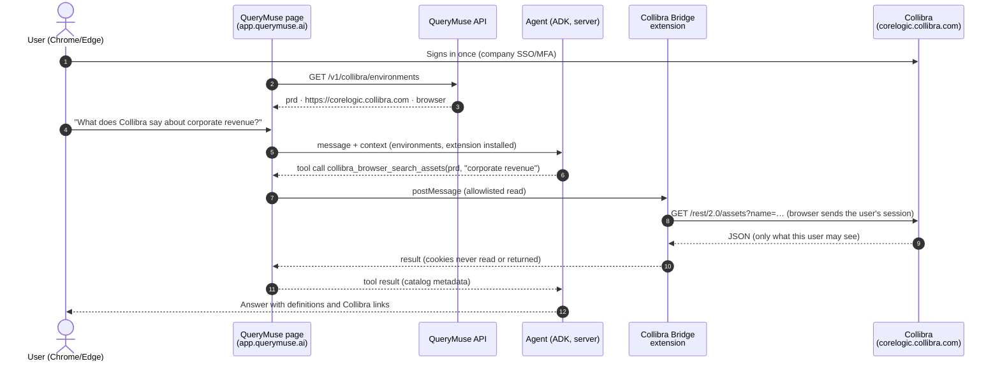
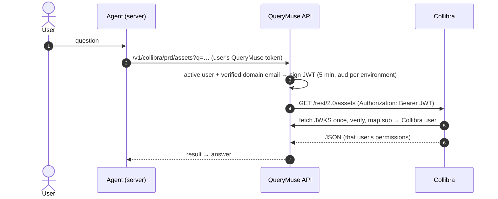
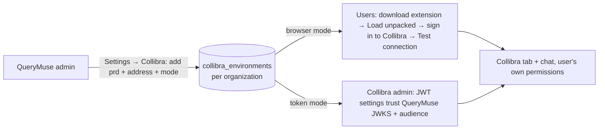

# Phase 5: Collibra Catalog Integration — Plan & Tracker

**Status (2026-11-19): live for Cotality in browser mode.** Collibra is an admin-managed data source; Cotality's admin added `prd` (`https://corelogic.collibra.com`) in Settings, users install the QueryMuse Collibra Bridge extension and use Collibra in chat and in the Collibra tab with their own Collibra sign-in. Token mode (no extension) is built and waits on Cotality's Collibra admin ([§4.2](#42-collibra-admin-setup-one-time-per-environment)). Summary: [§0](#0-summary-achieved-left-to-do-recommendations).
**Owner:** QueryMuse team · **First client:** Cotality (`cotality` tenant) · **Updated:** 2026-11-19
**Parent plan:** [one_data_navigator_mvp_dev_plan.md → Phase 5](one_data_navigator_mvp_dev_plan.md#phase-5-collibra-catalog-integration-post-v1-not-yet-scheduled)

## 0. Summary: achieved, left to do, recommendations

### 0.1 Achieved (2026-11-19)

| Area | What works | Verified |
|---|---|---|
| Data source per organization | Admins add/edit/remove Collibra environments in **Settings → Collibra data catalog** (name, address, access mode); changes in the activity log; everything Collibra is hidden for organizations without it | Cotality `prd` live in production |
| Browser mode (no Collibra change) | QueryMuse Collibra Bridge extension (Chrome/Edge MV3) reads Collibra with the user's own SSO session; read-only allowlist; never touches cookies | Real tenant, Cotality admin |
| Token mode (no extension) | QueryMuse signs 5-minute per-user tokens (RS256, `sub` = verified work email); public JWKS at `https://app.querymuse.ai/.well-known/jwks.json`; key in Secret Manager | Fake Collibra verifying our JWKS (real tenant pending Collibra admin) |
| Agent | Six server tools (`collibra_*`) and six browser tools (`collibra_browser_*`), led by a one-call **lookup** (search + rank + definitions + related) and a 10-minute per-user cache; picks by access mode; cites Collibra assets, never invents; gives setup steps + download link when the extension is missing | Real tenant ("Corporate Revenue" → product field → BigQuery column) |
| Collibra tab | Environment picker, search (contains / starts with / exact, paging), definition, attributes, clickable relations, **Open in Collibra**, **Use in chat** (scopes the chat) | Locally; real-tenant use by Cotality admin |
| Onboarding | **Download extension (zip)**, four steps and **Test connection** in Settings and the tab; same steps in chat | Production download (v0.2.0) |
| Quality | Backend tests (tokens, client, routes, admin, tenant isolation), extension policy tests in CI, Playwright end-to-end run | CI green |

### 0.2 How it works

**Browser mode** (live): the agent runs on the server, but Collibra calls run in the user's browser.



**Token mode** (built, waiting on Collibra admin): no extension; QueryMuse vouches for the signed-in user.



**Setup by role**



### 0.3 Left to do (priority order)

1. **Extension distribution without developer mode** — Chrome Web Store (unlisted) + client IT force-install;
   steps in [collibra_extension_publish.md](collibra_extension_publish.md). Then replace the zip button with
   **Add to Chrome**.
2. **Field-mapping workflow** (exit check): uploaded template → per field best match + runner-ups with evidence →
   saved as a workspace table (downloadable from Artifacts); cross-check matched columns against the user's
   connections ("cataloged, not queryable here").
3. **Collibra definitions in the Explorer dictionary** with provenance ("Collibra · PRD"), using the column's
   `dataset.table.column` name to find the Collibra column asset.
4. **INT environment** for Cotality (address + test), then run the exit check on PRD and INT.
5. **Token mode on the real tenant** after Cotality's security approval and JWT setup (§4.2), so users need no extension.
6. **Security review** (Phase 4): extension permissions and messaging, token issuer, data sent to the LLM.

### 0.4 Recommendations (optimization)

- ✅ **Done 2026-11-19 — one lookup call:** `collibra_lookup` / `collibra_browser_lookup` search, rank, describe the
  top matches (definition + key attributes) and list related assets for the top 3 in one tool call (was search →
  describe → relations, 3+ model turns). The agent is told to start every Collibra question with it.
- ✅ **Done 2026-11-19 — ranking:** results (lookup, search tools and the Collibra tab) are ordered by asset type
  (Business Term > Product Field > Data Attribute > … > Column/Table), status (Accepted/Approved up, Obsolete/Deprecated
  strongly down), name match with the question, and readable names over long physical paths; the score is returned
  and labelled as a heuristic. Same rules in `client.py` (`rank_score`) and `lib/collibra.ts` (`rankScore`).
  *Next:* filter by asset type (`typeIds`) once Cotality's type ids are known.
- ✅ **Done 2026-11-19 — short-lived cache:** successful Collibra reads are cached for 10 minutes per user (server:
  keyed by Collibra environment + user, max 2,000 entries, identity checks still run on cache hits; browser: in-page
  memory, cleared on reload/sign-out). Never shared across users, since Collibra permissions differ.
- **Use the Collibra search API** (full-text across names, descriptions and attributes) instead of name-only asset
  search when allowed; it finds "employee numbers" via definitions, not just names.
- **Batch describe:** read attributes for several assets in one request (`assetId` list) instead of one per asset.
- **GraphQL for lookups (later, if speed matters):** a lookup is ~15 REST calls; Collibra's GraphQL Knowledge Graph API
  could return the same in 1–2 queries. Only as fixed query templates shipped in the extension (page supplies just
  the search text and ids), never free-form queries; keep REST as the default for simplicity and security review.
- **Telemetry:** count Collibra calls, errors (not signed in / forbidden) and latency per organization, to see
  adoption and catch session expiry problems.
- **Token mode first for new clients:** it needs no install on users' machines; keep browser mode for clients who
  cannot change Collibra settings.
- **Extension hygiene:** publish one store listing for all clients (address comes from QueryMuse), pin a minimum
  version in the app (already supported), and keep the request allowlist unchanged unless reviewed.

### 0.5 FAQ (how browser mode works)

**Does searching in the Collibra tab use the AI model or tokens?** No. Searching, opening an asset and following
relations in the tab go straight to Collibra (through the extension in browser mode, or the API in token mode); no
model call, no tokens, nothing counted against LLM budgets. *Use in chat* only stores the selected asset; the next
chat message carries its name and id as a few tokens of context. Questions asked **in chat** use the model.

**Does browser mode use the Collibra connector (`idap_agents_glb-ag_foundation-collibra_connector`)?** No. It uses
QueryMuse's own **Collibra Bridge** extension. Same principle (the user's Collibra session stays on their machine;
read-only, bounded requests; the user's own permissions), different mechanism:

| | Collibra connector (KWAgent) | QueryMuse Collibra Bridge |
|---|---|---|
| What it is | Node.js CLI + local helper process | Chrome/Edge extension |
| Collibra sign-in | Opens its own dedicated Chrome window for SSO/MFA | Uses the sign-in already in the user's normal browser |
| Session | Cookies held in the helper's memory | Kept by the browser; the extension never reads cookies |
| Caller | KWAgent's agent on the same computer | The QueryMuse page, on behalf of the hosted agent |
| Allowed reads | Any bounded `GET /rest/2.0/...` (explicit `limit` 1–100) | Five fixed reads only (current user, asset search, asset, attributes, relations) |
| Install | npm + Node 20 + Chrome | Zip today; Add to Chrome after publishing |

Both call the **same Collibra Core REST API** (`/rest/2.0/`); neither offers writes or GraphQL. The extension's
allowlist and the agent tools were modelled on the connector's `get` rules and KWAgent's wrapper tools.

**How does the bridge query Collibra?**

```
QueryMuse page ──postMessage──▶ content script ──chrome.runtime──▶ service worker ──HTTPS GET──▶ Collibra REST API
 (app.querymuse.ai)              (on QueryMuse pages only)          (extension background)        (*.collibra.com)
        ▲                                                                                              │
        └──────────────────────────── JSON result, same path back ◀───────────────────────────────────┘
```

1. **Page** (`frontend/lib/collibra.ts`): a `collibra_browser_*` tool call or a Collibra-tab search posts a request
   (read type, parameters, the admin-configured Collibra address) to its own window.
2. **Content script** (`content.js`): runs only on QueryMuse pages, accepts messages only from that page, relays them.
3. **Service worker** (`background.js`, rules in `policy.js`): accepts only QueryMuse tabs and `https://*.collibra.com`
   addresses, validates the read against the allowlist, then calls Collibra with `fetch(…, credentials: "include")`;
   the browser attaches the user's Collibra session (the extension has host permission for `*.collibra.com`).

   | Purpose | Collibra REST call |
   |---|---|
   | Sign-in check | `GET /rest/2.0/users/current` |
   | Search by name | `GET /rest/2.0/assets?name=…&nameMatchMode=…&limit=…` |
   | Asset details | `GET /rest/2.0/assets/{id}` |
   | Definitions / attributes | `GET /rest/2.0/attributes?assetId={id}&limit=…` |
   | Relations / lineage | `GET /rest/2.0/relations?sourceId={id}` (or `targetId`) |

   SSO redirect / 401 / HTML page → "not signed in" with reason and sign-in link; 403, 404, 429, timeouts and
   responses over 2 MB are reported as such.
4. **Page shapes the JSON:** HTML definitions to plain text, profiling statistics dropped, ranking applied, same
   result format as the server tools, successful reads cached 10 minutes. One lookup ≈ 1 search + details and
   attributes for the top 5 (4 in parallel) + relations for the top 3.

The shaped catalog metadata goes to the agent as the tool result (and from there to the model). In browser mode
QueryMuse's server never calls Collibra and never holds Collibra credentials.

**Does the Collibra REST API use GraphQL?** No. `/rest/2.0/...` is Collibra's Core REST API: plain GETs with query
parameters returning JSON. Collibra also has a **separate** GraphQL Knowledge Graph API (e.g.
`/graphql/knowledgeGraph/v1`); the connector repo has captured responses from it, so it is available on
Cotality's Collibra, but neither the connector nor the bridge uses it (the bridge blocks it).

| | Core REST API (used) | GraphQL Knowledge Graph API |
|---|---|---|
| Style | One fixed request per resource | One query naming the fields and linked assets to return |
| Asset + definition + related assets | Several requests | Usually one |
| Locking down to bounded read-only use | Simple: fixed paths and parameters | Harder: query text must be checked or limited to fixed templates |

## 1. Goal

Let users and the agent search the Collibra data catalog (PRD and INT) for business definitions, field
mappings and lineage, so catalog tasks such as "find the best Collibra field for each requested field name"
are answered from Collibra evidence instead of the agent's own guesses.

**Why (2026-11-17):** a user attached a five-field mapping template (business name, business type, corporate
revenue, location sales, employee numbers) asking for a Collibra search across PRD and INT. With no catalog
tool, the agent mapped the fields against the allowlisted BigQuery schemas only and presented invented
definitions, confidence scores and environments as catalog facts. The agent now says when a system is
unavailable and labels its own matches as suggestions; this phase adds the real capability.

## 2. Findings (2026-11-19)

1. **QueryMuse sign-in does not give Collibra access.** Cotality users sign in to QueryMuse with Google OIDC
   (`cotality.com`). Collibra (`https://corelogic.collibra.com`) has its own SSO session in the user's browser;
   nothing in the QueryMuse session is accepted by Collibra today.
2. **The existing integrations are desktop-only.**
   - Collibra connector (`idap_agents_glb-ag_foundation-collibra_connector`, Node CLI): opens a visible
     browser for SSO/MFA, hands the session cookies to a local, memory-only HTTP client, serves bounded
     same-origin REST GETs over a current-user-only socket. No cookies leave the machine by design.
   - KWAgent stdio MCP wrapper (`docs/Collibra_MCP_wrapper.md`, branch `sdap-data-navigator`) and the
     `navigator_docker_env` Collibra tab call that CLI; disabled in Docker (`COLLIBRA_ENABLED=false`).
   - Neither can run on the hosted server: there is no browser for the user's MFA, and moving SSO cookies to a
     server is what the connector forbids. The wrapper doc: *"A login on the user's Mac does not authenticate
     the deployed agent."*
3. **Collibra REST API authentication** ([developer docs](https://developer.collibra.com/tutorials/collibra-json-web-token-authentication-guide.md)):
   - Basic auth (username/password) — SSO users have no Collibra password.
   - OAuth 2.0 **client credentials only** — app identity; no authorization-code flow, so no per-user
     "Connect Collibra" button.
   - Session login (`JSESSIONID`) — same password problem.
   - **JWT bearer** — Collibra validates a signed JWT against one configured JWKS URL / issuer / audience and
     maps a principal claim (default `sub`) to a Collibra username. Environment-wide setting in Collibra
     Console; documented for client applications (service accounts), not explicitly for forwarded user tokens.
4. **Layers stay separate** (wrapper doc): app login, Collibra-service authentication and Collibra
   authentication are distinct; one token must not be assumed valid for all three. With a shared identity,
   answers must not be presented as the user's own Collibra entitlements.

## 3. Hosted architecture

See the diagrams in [§0.2](#02-how-it-works). Principles:

- Collibra is configured **per organization and per environment** (`collibra_environments`, tenant RLS), by the
  organization's admin in Settings or by the operator CLI (`provision collibra`).
- **Browser mode:** catalog reads run in the user's browser through the extension; the server never holds Collibra
  credentials or sessions. **Token mode:** a read-only client in the API (not the agent) calls Collibra with a
  QueryMuse-signed per-user token, so tenant/user checks, logs and rate limits stay server-side.
- Read-only, bounded requests only (search, asset, attributes, relations, current user); no writes, workflows or
  GraphQL. No catalog content is shared across organizations or users.

## 4. Authentication: option A, QueryMuse-issued per-user tokens (decided 2026-11-19)

No service account is available, so QueryMuse calls Collibra **as the signed-in user**. Users sign in once
(to QueryMuse); they never sign in to Collibra inside the app, and their own Collibra permissions apply.

### 4.1 Design

Instead of forwarding the user's Google token, **QueryMuse signs its own short-lived token for Collibra**
(Collibra's JWT bearer authentication), after its own checks:

```
User ─(Google SSO / password)─▶ QueryMuse API: verified token → tenant, active user, verified-domain email
      API mints JWT {iss: https://app.querymuse.ai, aud: <env audience>, sub: <work email>, exp: +5 min} (RS256)
      API ──Authorization: Bearer <JWT>──▶ Collibra ── verifies via https://app.querymuse.ai/.well-known/jwks.json
                                                   └─ maps sub → Collibra user → that user's permissions
```

Why this beats forwarding Google ID tokens:
- Google tokens never leave QueryMuse; the Collibra token is useless against our API (different issuer and audience).
- Works for every sign-in method (Google SSO, Identity Platform password, future Okta/Entra), one issuer for Collibra.
- QueryMuse enforces what Collibra cannot: tokens are minted only for **active users** whose email is **verified and
  on the organization's verified domains**, and only for Collibra environments configured for **that organization**.
- 5-minute lifetime, audience bound per environment, `jti` per token; key in Secret Manager.

Implementation: `odn/platform/collibra/token.py` (key, JWKS, mint), `client.py` (bounded REST GETs),
`api/collibra_routes.py`, `agent/collibra_tools.py`, table `collibra_environments` (migration `0015`, RLS),
`provision collibra`, JWKS published by the frontend route `/.well-known/jwks.json`.
Prod key: Secret Manager `odn-collibra-signing-key` (RSA 3072), `ODN_COLLIBRA_SIGNING_KEY_SECRET`.

### 4.2 Collibra admin setup (one time, per environment)

Collibra Console → Infrastructure → environment → Data Governance Center service → Configuration → Edit → **JWT**:

| Setting | Value |
|---|---|
| JSON Web Key Set URL | `https://app.querymuse.ai/.well-known/jwks.json` |
| JWT Token Types | `jwt` (default `at+jwt,jwt` also works) |
| JWT Algorithms | `RS256` |
| JWT Issuer | `https://app.querymuse.ai` |
| JWT Audience | e.g. `querymuse-collibra-prd` (one per environment; must match QueryMuse's config) |
| JWT Principal ID Claim Name | `sub` (default) — QueryMuse puts the user's work email there (or the part before `@`) |

Save and restart the environment. Then the operator connects the tenant:

```sh
deploy/deploy.sh provision collibra cotality prd --url https://corelogic.collibra.com --audience querymuse-collibra-prd
# --principal email_local_part if Collibra usernames are not full emails
```

Users check it with the agent ("is Collibra connected?") or `GET /v1/collibra/prd/status`.

**Caveats to raise with Cotality:** Collibra has one JWT configuration per environment; if JWT auth is already used
for another issuer, it must be coordinated (e.g. a combined JWKS). Trusting QueryMuse's issuer means QueryMuse can
act as Cotality Collibra users who sign in to QueryMuse; mitigations above, plus logs of every Collibra call
(user, environment, operation) and key rotation via a new secret version.

### 4.3 Stopgap: Collibra Bridge browser extension (no Collibra change)

Same model as the KWAgent connector (the user's own Collibra SSO session stays on their machine), moved into
the browser so it works with the hosted app:

- **Extension** [`frontend/extension/collibra-bridge`](../frontend/extension/collibra-bridge/README.md) (Chrome/Edge
  MV3): a content script on QueryMuse pages relays requests to the service worker, which performs allowlisted
  read-only `GET /rest/2.0/...` calls with the browser's Collibra session (`credentials: "include"`). Cookies are
  never read or returned; SSO redirects are reported as "not signed in".
- **Frontend tools** (`frontend/app/components/CollibraBrowserTools.tsx`): `collibra_browser_status`, `_search_assets`,
  `_describe_assets`, `_get_relations`, `_get_api_fields`, registered with CopilotKit `useFrontendTool` only when the
  extension is present; same output as the server tools.
- **Agent:** `AGUIToolset(tool_filter=BROWSER_TOOL_NAMES)` exposes only those frontend tools; instructions use the
  server tools when `collibra_environments` is configured, else the browser tools.
- **Verified end to end** with Playwright Chromium + the extension + a fake Collibra requiring a browser session:
  not-signed-in detection, refused paths, cookie sent after sign-in, and a correct chat answer built only from
  Collibra data.
- **Verified on the real tenant (2026-11-19):** after the user signed in to `corelogic.collibra.com` with SSO in the
  same browser, the agent found "Corporate Revenue" assets, followed relations from the product field *Firmographics
  Brand and Corporation – Corporate Sales Revenue* to BigQuery column `corporate_revenue_sales_amount`
  (`vw_edr_firmographics_enterprise`), and quoted definitions from Collibra. Before sign-in it correctly reported
  "not signed in" with the login link. Follow-ups shipped: the extension reports why Collibra refused (redirect /
  401 / HTML page) and has a **Test connection** button (v0.1.1); data-profiling statistics on columns (percentiles,
  mean, variance…) are left out of `describe` results (count kept) to save model tokens.
- Trade-offs: needs the extension installed (developer mode for the pilot; Web Store/managed policy later) and the
  user signed in to Collibra in the same browser; agent turns using Collibra need the browser tab open.

### 4.4 Collibra as an admin-managed data source (2026-11-19)

Not every organization has Collibra, so it is set up per organization like a data source:

- **Settings → Collibra data catalog** (admins): add/edit/remove environments (name e.g. `prd`, Collibra address,
  access mode **browser** = each user's own Collibra sign-in via the extension, or **token** = QueryMuse sign-in,
  showing the JWKS URL/issuer to give the Collibra admin, plus audience and username format). Saved in
  `collibra_environments` (migration `0016`: `access_mode`, admin writes under tenant RLS), each change recorded in
  the organization's activity log. API: `GET/PUT/DELETE /v1/admin/collibra/environments[/{env}]`.
- **Gating:** the **Collibra** tab, the Settings section for users, the agent context and the browser tools appear
  only when the organization has an enabled environment. Server-side reads refuse browser-mode environments (409).
- **Extension download & guidance:** `https://app.querymuse.ai/downloads/querymuse-collibra-bridge.zip` (built on
  request from `frontend/extension/collibra-bridge`, versioned file name). Settings and the Collibra tab show
  the extension status, a **Download extension** button, four setup steps and **Test connection** (with a *Sign in
  to Collibra* link). When a user asks about Collibra in chat without the extension, the agent replies with the same
  steps and the download link. The extension now uses the Collibra address the admin configured (still restricted
  to `https://*.collibra.com`); its own setting is only a fallback.
- **Collibra tab:** environment picker, name search (contains / starts with / exact, paging), asset details
  (definition, attributes without profiling statistics, outgoing/incoming relations you can click through),
  **Open in Collibra** and **Use in chat**, which scopes the chat to that asset (chip above the chat; the agent
  receives the asset id and environment).

### 4.5 Alternative kept for later

**B. Tenant service account** (OAuth client credentials) — no Collibra-side JWT change, but everyone sees the
service account's view. Can be added as a second credential provider if Cotality prefers it.

### Open questions for Cotality's Collibra / platform owners

- [ ] Approve QueryMuse as a JWT issuer for Collibra (security review).
- [ ] Is Collibra JWT authentication already configured (JWKS / issuer in use)?
- [ ] Collibra username format — equal to the work email?
- [ ] Audience value per environment, PRD and INT base URLs (known: `https://corelogic.collibra.com`), rate limits.
- [ ] Data-handling rules for catalog metadata sent to the LLM.

## 5. Work breakdown

### 5.1 Connector & access (API)
- [x] `CollibraClient` (httpx): bounded same-origin REST GETs only — asset search, asset, attributes,
      relations, field inventory; timeouts, `limit` 1–100, no mutation or GraphQL. *(Retry with backoff on 429/5xx
      not yet added.)*
- [x] Credential provider: QueryMuse-signed per-user JWT (A); service account (B) can be added behind the same client.
- [x] Tenant config: `collibra_environments` (tenant_id, env, base_url, access_mode, audience, principal_format,
      enabled; migrations `0015`, `0016`), RLS ENABLE+FORCE and grants (guard test `tests/db/test_rls.py`).
- [x] Endpoints: `/v1/collibra/environments`, `/{env}/status`, `/{env}/assets?q=`, `/{env}/assets/{id}`, `/attributes`,
      `/relations`, `/fields`, `POST /{env}/describe`; per-user rate limit (120/min); every call logged (user, env, op).
- [x] Provision CLI: `provision collibra <tenant> <env> --url … [--audience … for token mode] [--principal …] [--disable]`;
      admin API `/v1/admin/collibra/environments` + Settings UI.

### 5.2 Agent tools & field-mapping workflow
Port the KWAgent wrapper's tool set:
- [x] `collibra_search_assets` (text, optional domain, `ANYWHERE`/`START`/`EXACT`, limit/offset, environment)
- [x] `collibra_environments`, `collibra_get_relations` (incoming/outgoing); single asset/attributes via describe
- [x] `collibra_describe_assets` (1–20 ids, per-asset errors)
- [x] `collibra_get_api_fields` (field inventory with continuation; nested containers listed, not yet expanded)
- [ ] Field mapping: for each requested field (e.g. rows of an uploaded template) search Collibra, prefer
      BigQuery-backed assets, return best match + runner-ups with evidence (asset link, definition,
      dataset · project · environment); heuristic scores labelled; unmatched fields labelled; result saved as
      a workspace table downloadable from Artifacts.
- [ ] Cross-check matched columns against the user's connections: confirm schema when allowlisted, else
      "cataloged, not queryable here".
- [x] Agent instructions: cite Collibra assets for every definition; never invent; say when Collibra is not
      connected; with option B, say answers reflect the shared catalog view.

### 5.3 UI
- [x] **Collibra** side-panel tab: status, search, asset detail; **Use in chat** scopes the chat to the asset.
- [ ] Explorer dictionary shows Collibra definitions with provenance ("Collibra · PRD").
- [x] Settings (admins): add, edit, remove and test Collibra per environment; users get extension download + steps + test.

### 5.4 Security & tests
- [x] Credentials only via Secret Manager / encrypted store; never in prompts, logs or tool output.
- [x] Tests: client bounds and error mapping (401/403/429/timeout/invalid JSON) with sanitized fixtures;
      tenant isolation of config and caches; agent tool contracts.
- [ ] Security review of both modes (Phase 4 review scope).
- [ ] Extension published (Web Store unlisted) and force-installed by Cotality IT ([guide](collibra_extension_publish.md)).

## 6. Exit check

The 2026-11-17 mapping template (business name, business type, corporate revenue, location sales, employee
numbers) is completed for PRD and INT with a Collibra asset link, definition and dataset · project ·
environment for every match; every definition traces to a Collibra asset, unmatched fields are labelled,
and nothing is invented.

## 7. Log

| Date | Note |
|---|---|
| 2026-11-17 | Phase 5 added after the invented-definitions incident. |
| 2026-11-19 | Auth research: SSO session not reusable on the server; options A (JWT) / B (service account); KWAgent wrapper design reviewed; tracker created. |
| 2026-11-19 | Option A (token mode) built: QueryMuse-signed per-user tokens + JWKS, `collibra_environments` (RLS), `/v1/collibra/*`, five agent tools, provision CLI, tests against a fake Collibra that verifies our JWKS; prod signing key created. |
| 2026-11-19 | Browser-extension stopgap built and verified end to end against a fake Collibra (no Collibra-side change needed). |
| 2026-11-19 | Bridge verified on the real Collibra tenant with the user's SSO session; diagnostics + profiling-attribute trimming added. |
| 2026-11-19 | Collibra as an admin-managed data source (Settings), Collibra tab with asset scope, extension download + setup guidance in Settings, the tab and chat. Next: field-mapping workflow to a workspace table, extension distribution (Web Store unlisted / managed policy). |
| 2026-11-19 | Extension distribution guide: [collibra_extension_publish.md](collibra_extension_publish.md) (Chrome Web Store unlisted + client IT force-install). |
| 2026-11-19 | **Live for Cotality:** admin added `prd` in Settings (browser mode); extension v0.2.0 from the Settings download; Test connection, Collibra tab and chat working on the real tenant. Summary, diagrams and recommendations added (§0). |
| 2026-11-19 | Optimizations: one-call lookup tools, ranking (business terms / accepted / readable names first), 10-minute per-user cache. |
| 2026-11-19 | FAQ added (§0.5): tab searches use no tokens; bridge vs. Collibra connector; how the bridge calls the REST API; REST vs. GraphQL. |
