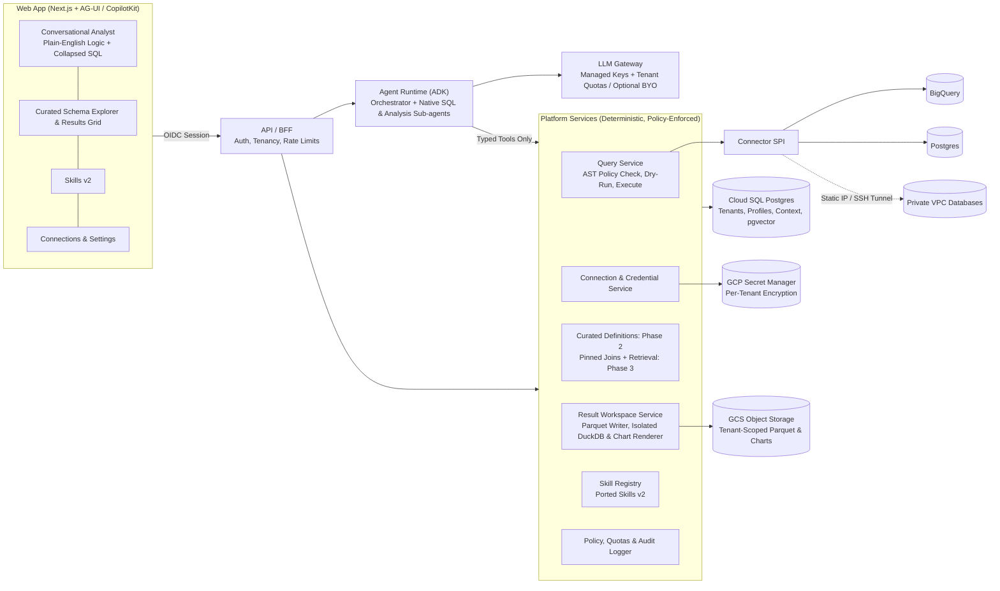

# QueryMuse (formerly One Data Navigator): MVP Architecture & Development Plan

**Status:** Final (v1.0) — in build. Spikes done; Phases 1–2 built; Phase 3 connector, connection manager and tenant & user system built; product renamed **QueryMuse** and hosted on a single GCP VM at `https://app.querymuse.ai` (since 2026-11-18; first hosted 2026-11-16 as `odn.datahop.ai`, see [deploy_gcp_vm.md](deploy_gcp_vm.md)) with three tenants (see [Progress Summary](#progress-summary-updated-2026-11-18)).

**Date:** 2026-11-14 (progress updated 2026-11-18)

**Supersedes:** [One_Data_Navigator_Architecture.md](One_Data_Navigator_Architecture.md) (Full Vision Proposal) for v1 scope and sequencing. The full vision remains the v2+ reference.

## 1. Product Redefinition & MVP Scope

### Product Vision (MVP)

**QueryMuse** ([querymuse.ai](https://www.querymuse.ai); formerly One Data Navigator / Smart Data Navigator) is a cloud-based, conversational data exploration and analysis workspace. It combines a familiar DBeaver-style schema browser with an AI data analyst that writes native SQL, caches results locally in an analytical workspace, and lets users slice, aggregate, and visualize data in plain English without re-querying expensive cloud warehouses.

**Primary persona:** Non-technical product managers and managers. The default
experience emphasizes understandable questions, business definitions, and
plain-English explanations; SQL remains available for users who want detail.

### Core Value Propositions (What We Are Shipping in v1)

1. **Zero-Install Cloud Workspace:** Connect to BigQuery and Postgres from a multi-tenant web app via OIDC SSO, with static egress IPs and SSH tunneling for private VPCs.

2. **Native Plain-English-to-SQL:** An agentic SQL assistant that writes dialect-native SQL directly against user-curated schemas and pinned joins—enforced by deterministic AST read-only guardrails.

3. **Zero-Cost Conversational Follow-Ups:** Query results land in an isolated Parquet + DuckDB session workspace. Follow-up questions ("group by region", "filter outliers", "plot a trendline") execute in milliseconds against Parquet without touching the source warehouse.

4. **Reusable Analytical Skills:** Ported Skills v2 workflows allowing teams to standardize repeatable multi-step analyses.

5. **Understandable Results & Curated Definitions:** Show concise calculation
   logic and source lineage with results, keep raw SQL collapsed by default,
   and provide a curated schema explorer with business-friendly definitions.

### Explicit Non-Goals (Cut or Deferred to v2)

To ship a reliable v1 within 13 weeks (1-week spike + 12 build weeks), the following capabilities from the initial proposal are explicitly **out of scope**:

* **Cross-Dialect SQL Transpilation:** We will *not* generate universal SQL and transpile via `sqlglot`. The LLM generates native SQL per target dialect; `sqlglot` is used strictly for AST read-only/allowlist security validation.

* **Deterministic Flows & Scheduler:** Automated YAML pipelines and cron scheduling are deferred until text-to-SQL accuracy and workspace stability are proven.

* **Custom Connectivity Gateway Agent:** Building an outbound-only customer-installed tunnel binary is deferred. v1 uses Cloud NAT static IPs and SSH bastion tunnels.

* **Snowflake & Oracle Connectors:** Deferred to v2 after the Connector SPI is proven on BigQuery and Postgres.

* **Automated AI Schema Crawling:** No bulk LLM description generation across thousands of tables. Context is opt-in at the dataset/schema level with user-curated descriptions and pinned joins.

* **Cross-Tenant Marketplace:** Multi-tenant data isolation is built in from Day 1, but public skill/flow sharing across organizations is deferred.

* **Arbitrary LLM-Generated Python:** v1 charts are produced from a typed, declarative chart spec rendered by platform-owned code. Free-form agent-written Python execution is deferred to v2 pending a dedicated sandbox security review.

* **Write-Back / DML:** v1 is strictly read-only against source systems.

## 2. MVP Architecture

### Key Architectural Decisions & Guardrails

1. **Connector SPI (BigQuery + Postgres):**

   * Uniform interface: `test_connection()`, `list_catalog()`, `get_schema()`, `estimate_cost()`, `execute_paged()`, `cancel_job()`, plus dialect/capability flags.

   * No MCP servers in the core execution path; all calls are direct, typed Python service invocations.

2. **AST Security Validation (Fail-Closed):**

   * Every query (from Chat, Explorer, or Skills) passes through `sqlglot` AST parsing configured for the connection's exact dialect.

   * Rejects DML/DDL, multi-statement scripts, `EXECUTE IMMEDIATE`, system catalog scrapes, and unapproved schemas/datasets. Backed by least-privilege database credentials.

3. **Memory-Isolated Result Workspace:**

   * Warehouse query results stream directly to Parquet files in GCS (`gs://<bucket>/<tenant_id>/<session_id>/<query_id>.parquet`), capped at 250MB / 500k rows for MVP. Results exceeding the cap are truncated, flagged as partial in the UI and agent metadata, and the user is prompted to narrow the query. BigQuery results are read via the Storage Read API (Arrow) where available.

   * The LLM receives *only* the schema, row count, summary stats, and at most a 5-row sample—never full result sets. The sample can be disabled per connection, and masked columns are always redacted from it.

   * DuckDB aggregations and chart rendering run inside an isolated Cloud Run worker pool (`concurrency=1` per container, strict RAM limits) to prevent OOM crashes in the main API/BFF. DuckDB runs with external access locked down (`enable_external_access=false`, `lock_configuration=true`, no extension installs) and can only read the Parquet artifacts of the caller's tenant/session, with per-query timeouts and memory limits.

   * Charts are produced from a typed chart spec (chart type, x/y fields, aggregation, filters) validated against the artifact schema; no agent-authored code is executed.

4. **Managed-First LLM Auth with Hard Budgets:**

   * Users onboard immediately using a platform-managed LLM key governed by strict per-tenant daily token/cost budgets. Enterprise BYO LLM key support is added in Phase 4.

5. **Tenant Isolation from Day 1:**

   * Every Postgres table, GCS path, cache key, and Secret Manager entry is strictly partitioned by `tenant_id`, resolved from the verified OIDC session in BFF middleware (never from client input) and enforced in depth with Postgres Row-Level Security.

6. **Network Egress & Private Connectivity:**

   * Cloud Run services egress via Direct VPC egress + Cloud NAT with reserved static IPs that customers can allowlist.

   * SSH bastion credentials (private keys, known-host fingerprints) are stored in Secret Manager; host-key verification is mandatory.

7. **Auditability:**

   * Every executed statement (source warehouse and DuckDB) is logged with `tenant_id`, `user_id`, connection, SQL text, policy decision, bytes/rows scanned, and latency. Rejected queries are logged with the rejection reason.

8. **PM-Friendly Logic and Schema Discovery:**

   * Each completed result and chart includes a one- or two-sentence
     plain-English explanation of the actual calculation, including relevant
     filters, aggregation, and source or workspace lineage. The explanation is
     grounded in the executed query and workspace transformations, not an
     unsupported claim about upstream lineage. When evidence is incomplete,
     label the limitation rather than inventing logic.
   * Raw source and follow-up SQL remain accessible in a collapsed-by-default
     details section; SQL is not removed from execution, provenance, or audit.
     Indicate partial/truncated results and distinguish source lineage from
     unverified upstream pipeline lineage.
   * Phase 2 provides an opt-in curated BigQuery schema explorer that imports
     existing source descriptions for approved objects and lets authorized
     data leads add or edit business definitions. Show source descriptions and
     curated definitions with provenance; mark missing definitions explicitly.
     Postgres descriptions are added when its connector arrives in Phase 3.
     Full automated crawling and bulk LLM-generated descriptions remain deferred.

## 3. MVP Development Plan & Actionable Todo Lists

**Target Timeline:** 13 weeks total — 1-week Pre-Build Technical Spike (Week 0) + 4 build phases (Weeks 1–12).

Each phase ends with an **Exit Check**. A phase is not closed until its Exit Check passes; slipped items roll forward explicitly rather than silently.

### Progress Summary (updated 2026-11-18)

**Where it runs:** production at `https://app.querymuse.ai` (since 2026-11-18; `querymuse.ai`/`www` redirect to it; `odn.datahop.ai` retired) (one GCP VM `odn-prod`, Docker Compose + Caddy, static egress IP `136.71.108.203`, Gemini via LiteLLM), release **`6282de7`** (deployed 2026-11-18; tenant & user system since `8407ddb`; migrations up to `0014`; pre-migration dump in `/opt/odn/backups/`). Mail: `support@querymuse.ai` (Microsoft 365 via GoDaddy) for people; invite/reset emails from `noreply@querymuse.ai` via Resend. Tenants: **Cotality** (Google SSO, `cotality.com`, BigQuery `idap-int`), **QueryMuse** (staff tenant, slug `datahop`; personal Google accounts by allowlist) and **Indulge** (email + password via Google Identity Platform, invite-only, shared Postgres on AWS RDS). Development uses the local Docker Compose stack (`docker-compose.yml`; `docker-compose.gcs.yml` switches the workspace to the real `gs://datahop` bucket under `odn/`): frontend, API/BFF, ADK agent, isolated DuckDB worker, Postgres + pgvector, mock OIDC IdP and fake GCS, with real BigQuery (`clgx-idap-bigquery-int-278e`) and AWS RDS Postgres. Quality gates: 365 backend tests (+3 end-to-end SSH tunnel tests that need a test bastion) and frontend type-check, run by GitHub Actions on every push (`.github/workflows/ci.yml`); `main` is green.

**Done**

| Area | Status |
|---|---|
| Spikes 1 & 2 | Done — policy suite 78/78 rejected, 17/17 allowed; worker sizing measured on real data. |
| Tenancy & auth | OIDC (PKCE) login, encrypted session cookie, BFF proxy with same-origin writes, verified tenant/user context, Postgres RLS on every tenant table. |
| Query path | `SqlPolicy` (fail-closed AST + allowlist) → dry-run cost gate → confirmation above 10 GiB → `maximum_bytes_billed` 100 GiB → capped execution → audit log for every allowed/rejected/failed query. |
| BigQuery connector | Catalog, schema, dry-run, Storage Read (Arrow), cancel, column index; catalog listing up to 10k tables per dataset. |
| Explorer | Allowlist-filtered tree, keyword search across datasets/tables/fields (+ curated definitions), hide-snapshots switch, draggable splitter, data dictionary panel, SQL runner with cost confirmation, **Preview data** (20 rows, first 10 columns; BigQuery adds `TABLESAMPLE SYSTEM (1 PERCENT)` for tables > 1 GB, Postgres uses quoted identifiers + `LIMIT` only). |
| Favorites & usage | Per-user favorite datasets/tables (star), tables recorded from every successful warehouse query; both rank first in search, tree and the agent's `list_tables`; agent tool `get_my_tables`. |
| Chat agent | ADK + LiteLLM; tools `list_connections`, `get_my_tables`, `search_tables_by_keyword`, `list_tables`, `get_table_schema`, `run_sql` (approval card above threshold, model cannot self-approve), `query_workspace`, `list_workspace`, `generate_chart`. |
| Result workspace | Warehouse results → Parquet in GCS (500k rows / 600 MB Arrow cap, partial flag) as `q1..qN`; DuckDB follow-ups and charts in the locked-down worker with zero warehouse re-scans; paged/sorted results grid and CSV download. |
| PM explanations | Deterministic (AST-based, no LLM) one-to-two-sentence logic and lineage per result/chart; SQL collapsed by default; partial/unknown states labeled. |
| Data dictionary | Live source descriptions + tenant-curated definitions (draft/approved/deprecated, history, data-lead edit only, allowlist-enforced). |
| Local connection config | `.env` drives the local connection allowlist: `BQ_DATASET_IDS` (list, multi-line block with `#` comments, or `*`; empty = all datasets) and `BQ_TABLES` (`dataset.table`; a dataset listed there is limited to those tables). |
| Telemetry & LLM budgets | `GET /v1/telemetry` (latency, bytes, DuckDB time, LLM tokens per tenant); per-tenant daily LLM token budget enforced before every model call with a user-facing stop message. |
| Hosting (2026-11-16) | Live on `odn.datahop.ai` (moved to `app.querymuse.ai` on 2026-11-18): VM `odn-prod`, Let's Encrypt TLS, tenants `datahop` and `cotality`, Cotality BigQuery connection `idap-int`, durable ADK sessions in Postgres (`adk` schema). |
| User settings (2026-11-16) | **Settings** tab: bring-your-own LLM key (Gemini, OpenAI, Anthropic, OpenAI-compatible; tested by listing models) used for that user's chat, with a per-user daily trial on the platform key (`ODN_LLM_TRIAL_USER_DAILY_TOKENS`) and a prompt to add a key once it runs out. Personal BigQuery connections (service-account JSON, Test connection, optional dataset/table allowlist) visible only to their owner via RLS (migration `0007`); tenant-shared connections remain. User keys are encrypted at rest (AES-256-GCM, `ODN_SECRETS_KEY`, bound to owner); OpenAI-compatible endpoints must be public https (SSRF guard). |
| UI redesign (2026-11-17) | Chat-first layout after the Google ADK web UI and the `navigator_docker_env` reference: brand bar, resizable/collapsible dark side panel (About, Chats, Explorer, Results, Artifacts, Settings) and an always-visible chat. Explorer tree/search lives in the panel; selecting a table scopes the chat ("Scoped to …" chip) and **Details & SQL** opens the dictionary and SQL editor as a workbench over the chat. New results open the Results tab automatically. Agent tool calls render as step cards with a **Show agent steps** toggle (failures and approvals always show). |
| Themes (2026-11-17) | Cotality look is theme A (`frontend/app/themes/cotality.css` + `themes/index.ts`). Components use only semantic CSS tokens, so a client theme is one CSS file plus one entry; the deployment picks it with `ODN_THEME` (default `cotality`). Charts take their colours from the theme. |
| Conversation history (2026-11-17) | **Chats** tab lists the user's conversations (agent `GET /conversations`, scoped to the signed-in user), titled from the first question; opening one restores its messages, step cards and latest result (ag_ui_adk `/agents/state`); delete with confirmation (`DELETE /conversations/{thread}`; its tables and charts stay in Artifacts); a reload reopens the last conversation. New threads use the thread id as the ADK session id. |
| Artifacts store (2026-11-17) | Migration `0008`: charts are saved automatically (`c1..cN` per conversation, `workspace_charts`) and uploaded files are stored (`workspace_files`), both owner-only via RLS. **Artifacts** tab lists every table, chart and file across conversations with type filters, a "this conversation" switch, previews (paged table, chart, image), CSV/file/PNG downloads and links back to the source conversation. API `GET /v1/artifacts`, `/v1/artifacts/{charts,tables,files}/{id}`; files download as attachments except raster images (`nosniff`, sandbox CSP). |
| File uploads & chat attachments (2026-11-17) | Paperclip in the chat input (and **Upload files** in Artifacts): files up to 20 MB (CSV, XLSX, images, PDF, TXT, MD, JSON) go to the Artifacts store; CSV/XLSX become queryable workspace tables (kind `upload`). The message carries only a reference; an agent `before_model_callback` replaces it with a short note (table, columns, first 5 rows, plus any text written above the header), so file contents are not sent to the model. The importer detects the real header row below title/instruction lines and makes SQL-friendly column names. `openpyxl` added for XLSX. |
| Agent guardrails (2026-11-17) | App context (selected table, uploaded files) now reaches the prompt: ag_ui_adk only stored it in session state, so the instruction appends it on every call. The agent is told to use DuckDB double-quote identifiers in workspace SQL, to say up front when a request needs a system it cannot reach (e.g. Collibra), and never to present invented definitions, scores or environments as facts. Found while testing a Collibra field-mapping template (see Phase 5). |
| Postgres connector (2026-11-17) | `PostgresConnector` on the `BaseConnector` SPI (`303f56b`, fixes `cf2c811`): async `psycopg` pool, `EXPLAIN (FORMAT JSON)` cost/row estimate, `statement_timeout` per query, cancellation by backend PID, catalog/schema/column listing with `pg_description` comments, `sslmode`. SSH bastion tunnel: the first version could not work and would have stored the private key in plaintext; rewritten in `bf2c027` (encrypted key, SHA256 host-key pin, verified end to end through a real bastion). Wired into the connection service (`969b932`) and API (`abced93`). Verified against AWS RDS `devindulge_aws`: browse, preview and a chat count over `public.businesses`. |
| Postgres connection manager (2026-11-17) | Settings → Data connections now creates/edits Postgres profiles (`c0fba60`, `37899b6`, per [UI_Design_note.md](UI_Design_note.md)): host/port/db/user/schema/SSL, optional SSH tunnel, and **Test connection** with step diagnostics. Personal connections stay owner-only via RLS. |
| Agent schema discovery (2026-11-17) | A chat count query had explored 51 tables with 23 queries. Fixes: instructions with a discovery order (scoped table/connection → ask which connection → favorites/recent → keyword search → full listing only on request) (`3502345`, `0b11adb`) and a new `search_tables_by_keyword` tool that ranks table names without per-table schema calls (`73b9cc7`). Design and tests: [SCHEMA_DISCOVERY_STRATEGY.md](SCHEMA_DISCOVERY_STRATEGY.md), [OPTIMIZATION_SUMMARY.md](OPTIMIZATION_SUMMARY.md), [TESTING_SEMANTIC_SEARCH.md](TESTING_SEMANTIC_SEARCH.md). |
| Agent scoping & Postgres read-only (2026-11-17) | Explorer shares the connection the user picked (remembered across reloads) with the agent, which then stays on it; a connection selected only by default is not a scope. Postgres queries are read-only at the database (`default_transaction_read_only=on` on every connection, `SET TRANSACTION READ ONLY` per query on its own connection), tested against live Postgres; this also fixed a pooled-connection leak. |
| Rebrand to QueryMuse (2026-11-18, `98797b6`) | Product name **QueryMuse** in the brand bar ("{tenant} \| QueryMuse"; the staff tenant shows just "QueryMuse"), page titles, sign-in, agent persona and API titles. App at `https://app.querymuse.ai`; `querymuse.ai` and `www` redirect to it (Caddy, `ODN_REDIRECT_HOSTS`); `odn.datahop.ai` retired (no redirect). GoDaddy DNS `@`/`www`/`app` → `136.71.108.203` (same IP, so client database allowlists are unchanged); OAuth redirect and Identity Platform authorized domain moved; staff tenant `datahop` renamed **QueryMuse**. Internal identifiers (`odn` package, `ODN_*` settings, GCP project `datahop-514819`, bucket `gs://datahop`) unchanged. Runbook: [deploy_gcp_vm.md §5](deploy_gcp_vm.md#5-moving-to-a-new-domain-querymuseai). |
| Tenant & user system (2026-11-17, deployed `8407ddb`) | Per [Tenant_Isolation_User_system.md](Tenant_Isolation_User_system.md): tenant directory in Postgres (domains verified by DNS TXT or attestation, identity-provider mappings, status, join policy, theme) replacing the env mapping; Google SSO + email/password via Google Identity Platform (multi-tenant, `datahop-514819`); sign-in card with organization + work email; refresh tokens; invites, roles, disable and an admin activity log in a new **Organization** tab; brand bar "{tenant name} \| Smart Data Navigator" (now "QueryMuse"); RLS guard test, GCS key assertion, tenant-keyed caches; CI; shared connections managed in Settings by admins/data leads with tenant-bound encrypted secrets. Migrations `0009`–`0012`. |
| Postgres in production (2026-11-18, `2ef1122`) | Metadata calls (Test connection, catalog, schema, columns, `EXPLAIN`, cancel) use one short-lived read-only connection each instead of a per-request async pool: verified on Indulge's RDS, no connections left open and no more "Event loop is closed" errors. `EXPLAIN` row estimates fixed; row counts from `pg_class.reltuples`. The agent no longer queries `information_schema` / `pg_catalog` / `pg_stat_*` (blocked by the policy). Indulge's database user `reporting` checked: least-privilege (keep as the onboarding requirement). |
| Sign-in logging & cleanup (2026-11-18, `19709c5`) | Failed sign-ins recorded as `auth.failed` in the organization's activity log (reason + method, never the password; attributed only when the email's verified domain matched; repeats once per 10 min). Branded set-password page `/auth/action`. Legacy `ODN_OIDC_TENANT_DOMAINS` / `ODN_OIDC_DEFAULT_TENANT` and `tenants.oidc_issuer` removed (migrations `0013`, `0014`); test Identity Platform and local test tenants deleted. |
| Branded invite & reset emails (2026-11-18, `6282de7`) | Sent by us through Resend from `QueryMuse <noreply@querymuse.ai>` (domain verified: DKIM `resend._domainkey`, SPF/MX on `send`), reply-to `support@querymuse.ai`; subject and body name the organization; the button opens our `https://app.querymuse.ai/auth/action` page (Identity Platform link via `returnOobLink`). Key in Secret Manager `odn-resend-api-key` (`ODN_RESEND_API_KEY_SECRET`); any failure falls back to Identity Platform's own email; local dev uses the fallback. Links expire after 1 hour (Identity Platform default). |

**Results so far (verified)**

- Hosted login, browse and chat query on `odn.datahop.ai` (2026-11-16) with personal and `cotality.com` Google accounts.
- Workspace flow (locally): 1 BigQuery scan → 3 DuckDB follow-ups + a chart with zero further warehouse scans in the audit log.
- 2026-11-17, locally with real BigQuery and the shared trial model:
  - A chat count query ran with step cards and the Results tab opening on its own.
  - An uploaded CSV was charted by the agent without being told the table name; the chart was saved as `c1`, previewed, and exported as PNG.
  - A reopened conversation restored its messages, steps and result.
  - A deleted conversation's artifacts remained, labelled as from a deleted conversation.
  - A user's 5-field Collibra mapping XLSX now imports with the header on row 2 and its instructions kept as notes.
- 2026-11-17 (evening), locally against AWS RDS Postgres `devindulge_aws`:
  - Connection test, Explorer browse and preview of `public.businesses`.
  - Chat answered "businesses in Las Vegas and San Diego by status and published" correctly (7 rows), but only at **q6**: with only the connection picked, the agent still started with `list_connections` and BigQuery `idap-int` (fixed the same day: *Agent scoping* above).
- 2026-11-17, locally: SSH tunnel end to end through a real bastion to a private Postgres (query, wrong host key refused, wrong key refused).
- 2026-11-18, **in production**:
  - Indulge's first admin (`kevinwan@indulgetheapp.com`) set a password from the invite email and signed in; all three tenants have an active admin.
  - Indulge's shared Postgres connection (AWS RDS, direct, no tunnel) answered **46 chat queries**; **2 were rejected** by the SQL policy because the agent tried to read the system catalog (correct refusal, wasted calls; fixed in `2ef1122`).
  - After the Postgres fixes, no connections from the app were left open on Indulge's RDS.
  - Cutover to `app.querymuse.ai`: page and sign-in redirect served on the new host; `querymuse.ai/x?y=1` → `301 https://app.querymuse.ai/x?y=1`, `www` → `301`, `http` → `308`; Google sign-in returns to `https://app.querymuse.ai/auth/callback`.
  - A branded reset email for the Indulge admin was accepted by Resend (no fallback); key read from Secret Manager in the API container.

**Left to do (in priority order)**

1. **Domain & mail follow-ups (operator, in consoles):**
   - Confirm the branded reset email reached the Indulge admin's inbox (not spam); Resend → Logs shows delivery.
   - Turn on DKIM for the `support@querymuse.ai` mailbox (GoDaddy Email & Office dashboard; adds `selector1/selector2._domainkey` CNAMEs). DMARC is `p=quarantine`, so without DKIM forwarded mail can land in spam.
   - Delete the `odn` A record in `datahop.ai` DNS and the old OAuth redirect URI `https://odn.datahop.ai/auth/callback`; set Google Auth Platform branding (name QueryMuse, home page `https://www.querymuse.ai`, authorized domain `querymuse.ai`).
   - Tell Cotality and Indulge users the new URL `https://app.querymuse.ai`.
2. **Production hardening:**
   - CI image builds; widen ruff to `odn/platform` and `tests/platform` after fixing their existing findings.
   - Summary stats for the LLM.
   - Keyboard-accessibility tests for the explorer, dictionary and panel tabs (incl. Organization).
   - Run the Phase 2 exit check on the hosted URL.
   - Email: watch the Resend free tier (100/day, 3,000/month); consider a resend button for expired invites (links last 1 hour).
3. **Workspace retention:** decide the Parquet/upload TTL and whether users can delete individual artifacts (only whole conversations can be deleted today; their artifacts are kept).
4. **Architecture sign-off:** close the [Open Decisions](#6-open-decisions-to-close-at-spike-sign-off).
5. **Phase 3 remainder:** Postgres descriptions in the curated explorer; opt-in pgvector metadata sync and semantic (embedding) table retrieval to replace keyword matching; pinned joins and verified metrics; an SSH-tunnel test against a client's real bastion.
6. **Phase 4:** Skills v2, column masking, security review (now including the sign-in flows, emails and tunnels), load test, pilot onboarding guide.
7. **Phase 5 (post-v1):** Collibra catalog integration.
8. **Phase 6 (TBD):** the 50-question gold benchmark, per-IP sign-in rate limiting and two-factor sign-in.
9. **Later options:**
   - A QueryMuse website at `www.querymuse.ai` (today it redirects to the app) and a QueryMuse default theme for non-Cotality tenants.
   - Pass attached images to vision-capable models; today the agent knows an image was attached but cannot see it.
   - Additional enterprise themes (B, C, D) as clients onboard (Indulge uses the default theme).
   - A small usage view for telemetry.

### Pre-Build: 1-Week Technical Spike (Week 0, Gate to Phase 1)

*Goal: De-risk the two hardest technical boundaries before writing production application code.*

- [x] **Spike 1 — AST Policy Boundary:** Build a standalone Python script with `sqlglot` and run 50+ adversarial SQL test cases (CTEs hiding `INSERT`/`UPDATE`/`MERGE`, `EXECUTE IMMEDIATE`, multi-statement scripts, comment/quoting tricks, cross-project joins, `INFORMATION_SCHEMA` / `pg_catalog` scrapes, unparseable syntax) across BigQuery and Postgres dialects. Verify 100% fail-closed rejection with zero false negatives; the suite becomes the seed CI regression set.
  - *Result (2026-11-14):* Implemented directly as `odn.platform.policy.SqlPolicy` (sqlglot 30.x; BigQuery, Postgres, DuckDB). 78/78 adversarial cases rejected with specific reasons, 17/17 legitimate queries allowed (`backend/tests/policy/test_sql_policy.py`). Known trade-offs: trailing comments after `;` are rejected (fail-closed); allowlist matching is case-insensitive; Postgres side-effecting user functions are not detectable by AST, so `READ ONLY` transactions + least-privilege roles remain mandatory.
- [x] **Spike 2 — Parquet/DuckDB Memory Benchmark:** Stream a 500k-row BigQuery result into a GCS Parquet file, then execute 5 chained DuckDB group-by/window queries and a chart render from a typed chart spec inside a 2GB RAM Cloud Run container. Record p95 latency and peak RSS; use results to fix the worker RAM size and the result cap.
  - *Synthetic run (narrow 7-column data):* `backend/spikes/duckdb_benchmark.py` in the worker container (2 GB, 1 CPU, read-only FS). 500k rows → 18 MB Parquet / 44 MB Arrow; chain p95 44 ms; peak RSS 447 MB. 2M rows: chain p95 129 ms, peak RSS 637 MB.
  - *Real BigQuery run (2026-11-14):* `backend/spikes/bq_to_parquet.py` streamed 500k rows of `stg_property_firmographics.stg_combined_bus_name` (52 columns) via the Storage Read API (Arrow, single stream, stop-at-N rows, no query scan) → 58.6 MB Parquet in GCS. Worker: 299 MB Arrow in memory; 5-step policy-checked chain p50 87 ms / p95 134 ms; chart render p50 18 ms / p95 273 ms (first render is cold); peak RSS 843 MB. Engine lockdown (`enable_external_access=false`, `lock_configuration=true`) blocked file reads, `ATTACH`, and re-enabling access.
  - *Findings:* (1) Arrow is ~5× Parquet for wide real data (2.4× for synthetic), so a 250 MB Parquet cap could need ~1.3 GB of Arrow plus ~350 MB baseline and download buffers, which risks OOM in a 2 GB worker. (2) Single-stream Storage Read from a laptop ran at ~3.3k rows/s (~150 s for 500k rows), limited by the local network link; this must be re-measured from Cloud Run in-region, and multiple parallel streams should be used.
  - *Decision proposed for sign-off:* keep 2 GB workers; enforce the result cap as **500k rows AND ≤ 600 MB in-memory Arrow** (summed per batch in `QueryService` while streaming); the worker downloads to a stream/file rather than holding Parquet bytes and Arrow at the same time.
- [ ] **Architecture Sign-Off:** Lock MVP decisions — see [Open Decisions](#6-open-decisions-to-close-at-spike-sign-off).

### Phase 1: Foundation, Tenancy & BigQuery SPI (Weeks 1–3)

*Goal: Hosted multi-tenant shell with OIDC login, AST policy engine, and direct BigQuery querying in Explorer and Chat (replacing MCP).*

- [ ] **Infrastructure & Tenancy:**
  - [ ] Provision GCP environment via IaC (Terraform): Cloud Run (API/BFF & Agent), Cloud SQL (Postgres + `pgvector`), GCS bucket with 24h lifecycle deletion, Secret Manager, Direct VPC egress + Cloud NAT (static egress IP), and separate dev/staging environments.
    - *Superseded for the MVP (2026-11-16):* a single GCP VM with Docker Compose instead of Cloud Run/Terraform; see [deploy_gcp_vm.md](deploy_gcp_vm.md) (static IP, firewall, VM service account, Secret Manager, daily disk snapshots; Postgres runs on the VM instead of Cloud SQL). Earlier findings for the Cloud Run/GKE options, kept for v2: the approved GHA platform has no Cloud Run deploy workflow, Terraform must live in a separate `{org}-{space}-iac` repo, Python CI is Poetry-based, and environment names are `dev/int/uat/prd` (no `staging`). The existing KWAgent path is Jenkins + Helm on CNTV GKE with Vault secrets. Local development runs fully in Docker Compose meanwhile.
  - [x] Implement OIDC SSO authentication in Next.js + BFF; inject verified `tenant_id` and `user_id` into request context middleware.
    - *Done:* BFF side (`odn.tenancy`, `odn.api.deps`): JWKS-verified asymmetric-only tokens (issuer/audience/exp required), tenant resolved server-side from issuer + tenant claim, user upserted under RLS. Next.js (`frontend/app/auth/*`, `frontend/lib/*`): authorization code + PKCE + state + nonce via `openid-client`, session in an encrypted (A256GCM) HttpOnly cookie, `/api/odn/*` proxy adds the bearer token and enforces same-origin on writes. IdP-agnostic; verified locally against the mock IdP. Token refresh added 2026-11-17 (refresh tokens kept in the sealed session; Identity Platform always, Google when it issues one).
  - [x] Create core Postgres schema (`tenants`, `users`, `connections`, `audit_logs`) with Row-Level Security policies and cross-tenant isolation tests in CI.
    - *Done:* `backend/src/odn/db/migrations/0001_core.sql` (FORCE RLS keyed on a transaction-local `odn.tenant_id`, fail-closed when unset; append-only audit log; tenant directory only reachable via a security-definer lookup). Isolation tests and an every-table-forces-RLS guard in `backend/tests/db/test_rls.py`, run in CI.
- [ ] **Connector SPI & Query Service:**
  - [x] Define Python `BaseConnector` ABC and Pydantic data contracts (`CatalogNode`, `TableSchema`, `CostEstimate`, `QueryResultMeta`).
  - [x] Productionize the Spike 1 `sqlglot` AST read-only & object-allowlist validator (fail-closed) with the adversarial suite running in CI. *(Runs in CI on every push.)*
  - [x] Implement `BigQueryConnector` (service-account credential resolver via Secret Manager, dry-run byte estimation, `maximum_bytes_billed` cap, job timeout, and cancellation).
    - *Done:* verified against `clgx-idap-bigquery-int-278e` locally. Secret refs must be tenant-prefixed Secret Manager names (`odn-<tenant_id>-*`) or, in local dev only, `file:` refs under `keys/`; there is no fallback to the platform identity. Explorer catalog/schema calls are filtered by the same allowlist as queries.
  - [x] Write an audit log record for every executed and rejected query.
- [ ] **UI & Agent Parity:**
  - [x] Wire Next.js Schema Explorer endpoints directly to `QueryService` (removing all legacy MCP server dependencies).
    - *Done:* `frontend/app/components/Explorer.tsx`: connection picker, allowlist-filtered dataset/table tree, schema panel, read-only SQL runner with the dry-run confirmation card, rejection messages, and a basic results grid (virtualized grid comes in Phase 2).
    - *Keyword search:* `GET /v1/connections/{id}/search-index` builds an allowlist-filtered dataset → table → field index (one `INFORMATION_SCHEMA.COLUMN_FIELD_PATHS` query per dataset, nested fields included, cached 1h per tenant/connection/allowlist, gzip). The explorer searches it client-side (all terms must match across dataset/table/field names and field descriptions), shows an auto-expanded highlighted hierarchy with counts and ranked field hits, and opens the table with the chosen field focused. Layout stacks on narrow screens.
    - *Added (2026-11-15):* hide-snapshots switch (timestamped copies such as `*_20261022`), draggable/keyboard-resizable splitter, per-user **favorites** (star datasets/tables) and **recently queried** tables (recorded from every successful warehouse query, migration `0004`) ranked first in search and the tree, and **Preview data** (20 rows, 1% block sample on tables > 1 GB, first 10 columns — BigQuery checks the billing cap against unsampled column sizes, so `SELECT *` is avoided). Views cannot be sampled and keep the normal cost gate.
  - [x] Connect ADK SQL sub-agent to `QueryService` typed tools; enforce confirmation cards when dry-run cost exceeds tenant threshold.
    - *Done:* `backend/src/odn/agent/` (ADK 2.14 + ag-ui-adk, LiteLLM proxy model from `LITELLM_*`). Tools `list_connections`, `list_tables`, `get_table_schema`, `run_sql` call the API as the signed-in user (token kept in a request context variable, never in session state). Over-threshold queries pause via ADK `request_confirmation` (resumable app) and render as an approve/deny card in chat; the tool re-checks that the approved payload matches the paused SQL, so the model cannot self-approve. The model receives a 5-row sample; the full grid reaches the UI through agent state. Sessions are in-memory and scoped per tenant+user (durable sessions later). The agent checks the user's favorites and recently queried tables first (`get_my_tables`; `list_tables` ranks them first).
  - [ ] Draft the first 25 BigQuery gold-benchmark questions and record a baseline execution accuracy.
    - *Not started:* questions and expected answers need the pilot data owners (no invented questions/answers).
- [x] **Exit Check:** Authenticated user logs into the hosted URL, browses BigQuery datasets, and runs a chat query; CI verifies cross-tenant isolation and 100% rejection on the adversarial SQL suite; current MVP BigQuery features work with no MCP.
  - *Passed:* hosted login, browse and query on `odn.datahop.ai` (2026-11-16); GitHub Actions runs the isolation and adversarial suites on every push (2026-11-17). Phase 1 items left: the gold benchmark (rolled into Phase 3) and IaC (superseded by the single VM).

### Phase 2: Result Workspace, PM Explanations & Curated Schema — *Core MVP* (Weeks 4–6)

*Goal: Enable multi-turn exploration and charting without re-querying BigQuery, while helping PMs understand results and discover available fields.*

- [ ] **Parquet Persistence & Workspace Storage:**
  - [x] Update `QueryService` to stream BigQuery results into GCS Parquet files (enforcing the 250MB / 500k-row cap with a partial-result flag) and return only metadata, summary stats, and the optional 5-row preview to the ADK agent.
    - *Done (2026-11-15):* `odn.platform.workspace.service` streams warehouse results through a `ParquetSink` (500k rows / 600 MB Arrow cap per Spike 2) to `gs://datahop/odn/<tenant>/<user>/<session>/<artifact>.parquet`; artifacts `q1..qN` are recorded in RLS-protected `workspace_artifacts` with SQL, parents and source tables. **Remaining:** summary stats (per-column min/max/null counts) for the agent.
  - [x] Build frontend Results Grid component with virtualized scrolling, sorting, and CSV download backed by paginated Parquet reads.
    - *Done:* `ResultsGrid.tsx` — server-paged (100 rows) and server-sorted via worker `/v1/rows`, accessible sortable headers (`aria-sort`), streamed CSV download of the full artifact (`/artifacts/{qN}/csv`). Paging stands in for virtualization for now.
- [ ] **Isolated DuckDB & Chart Worker:**
  - [ ] Deploy isolated Cloud Run worker service (`concurrency=1`, RAM sized from Spike 2) exposing internal-only endpoints for DuckDB SQL execution and chart rendering.
    - *Local equivalent done:* separate `worker` container (2 GB, 1 CPU, read-only FS, all capabilities dropped, no host port, shared-token auth). The MVP runs this same container on the prod VM; Cloud Run is deferred.
  - [x] Lock down DuckDB (external access disabled, configuration locked, tenant/session-scoped file access, per-query timeout and memory limit) and run DuckDB SQL through the same AST read-only validator.
    - *Done:* worker `/v1/query` + `/v1/rows` (shared-token auth, object keys confined to the workspace prefix, only the referenced artifacts loaded, policy re-checked against exactly those inputs, interrupt-based timeout, row/byte caps). The API validates first and audits every workspace query (`source=workspace`, `dialect=duckdb`).
  - [x] Add `query_workspace` (DuckDB) and `generate_chart` (typed chart spec) tools to the ADK Analysis sub-agent. *(`query_workspace`, `list_workspace`, `generate_chart` done. Charts: typed spec → worker aggregates with schema-validated identifiers → dependency-free accessible SVG (bar/line/scatter, series, tooltips, data table + CSV fallback). Verified live: "top 10 states" bar chart from `q2` with no warehouse re-scan.)*
  - [x] Persist charts and uploaded files alongside result tables in a per-user artifacts store, browsable across conversations. *(Done 2026-11-17 — see Progress Summary: Artifacts store, File uploads & chat attachments.)*
  - [x] Implement session workspace state tracking so follow-up prompts ("break that down by week", "remove nulls and plot bar chart") automatically target the active Parquet artifact, with lineage back to the source query.
    - *Verified live:* 1 BigQuery scan (656 MB) → `q1`; 3 DuckDB follow-ups (321/54/10 rows, ~0.3–1.4 s) with zero further warehouse scans in the audit log; a two-turn chat answered the follow-up with `query_workspace` only. Chat results panel shows the artifact name, warehouse-vs-workspace badge, derived-from and source tables.
- [x] **Data Lineage & Logic for PMs:**
  - *Done (2026-11-15):* `odn.platform.workspace.explain` builds explanations deterministically from the executed SQL's AST (sqlglot) plus recorded lineage — no LLM — so an explanation cannot describe a calculation that did not run. Shown above each result grid and chart; SQL stays in a collapsed details section. Partial results, unverifiable sources and parse failures are stated explicitly. 16 fixture tests (filters, aggregations, joins, windows, CTEs, unions, unparseable SQL, partial results).
  - [x] Add a one- or two-sentence explanation beside each completed table or
    chart, grounded in the executed source query and any workspace
    transformations. Summarize relevant filters and aggregations and identify
    the source or explicitly state when lineage/logic cannot be verified.
  - [x] Show source SQL and DuckDB follow-up SQL in an accessible,
    keyboard-operable details section collapsed by default; preserve audit
    records and clearly label partial results or missing lineage.
  - [x] Test explanations against query and workspace evidence, including
    filters, aggregations, multiple follow-ups, partial results and failures;
    do not report an unexecuted or failed calculation as completed.
- [ ] **Curated Schema Explorer & Data Dictionary:** *(features done; accessibility tests and masking outstanding)*
  - *Done (2026-11-15):* `data_definitions` + `data_definition_history` (RLS, migration `0003`), `GET .../dictionary` (live source descriptions merged with curated definitions; `not_found` / `permission_denied` / `unavailable` states), `PUT .../definitions` (data lead/admin only, allowlist-enforced, versioned). Explorer `DictionaryPanel` shows source vs. business definition with status and provenance, “Definition unavailable” when absent, inline edit for data leads; curated definitions are searchable. The agent's `get_table_schema` includes curated definitions. Masking policy arrives with Phase 4 column masking.
  - [x] Import existing BigQuery table and column descriptions for explicitly
    selected, approved objects via the connector; retain source identity,
    update time and missing/permission-error states without broad crawling.
    *(Read live per approved table rather than copied, so they never go stale.)*
  - [x] Provide a simple accessible UI and API for authorized data leads to
    add or edit tenant-scoped business definitions. Preserve source
    descriptions separately; show definition provenance and update status.
    Enforce verified tenant/user identity and authorization on reads and edits.
  - [x] Display searchable table/field names, types and available definitions
    beside the Phase 2 chat workspace; show “definition unavailable” when
    absent, rather than generating one. Exercise the same object allowlist
    and masking policy as query access. *(Allowlist enforced; masking is Phase 4.)*
  - [ ] Add fixture tests for imports, missing descriptions, metadata
    permission failures, edits, tenant isolation, and keyboard accessibility.
    Postgres import follows its Phase 3 connector; semantic indexing and
    bulk automated crawling are not Phase 2 dependencies.
    *(Edits, allowlist and tenant isolation covered in `tests/db/test_dictionary.py`; import/permission-failure fixtures and keyboard-accessibility tests remain.)*
- [ ] **Internal Alpha Launch:**
  - [x] Add basic telemetry (query latency, dry-run bytes, DuckDB execution time, LLM token usage per tenant).
    - *Done (2026-11-16):* query latency, dry-run vs billed bytes and DuckDB time come from the audit log; LLM tokens are recorded per tenant/user/day/model in `llm_usage` (migration `0005`) by an ADK `after_model_callback` (only the agent can report, via `X-ODN-Agent-Token` + the user's token). `GET /v1/telemetry?days=N` (data lead/admin) returns daily p50/p95 latency, executed/rejected/failed counts and bytes per engine (warehouse vs DuckDB) plus LLM requests/tokens/users per model. No UI yet.
  - [x] Enforce per-tenant daily LLM token/cost budgets on the managed key (hard stop + user-facing message).
    - *Done (2026-11-16):* `before_model_callback` checks `GET /v1/llm-budget` before every model call and, at or over the limit, answers with a plain message (used/limit, reset time 00:00 UTC, Explorer still works) without calling the model; fails closed if the budget can't be checked. Default `ODN_LLM_DAILY_TOKEN_BUDGET` (2M tokens/tenant/UTC day); per-tenant override in `tenant_llm_budgets` (operator-managed, read-only to the app). A single in-flight call can overshoot slightly; the next call is stopped. Token-based for now; cost-based limits need per-model prices.
- [ ] **Exit Check:** Alpha user executes 1 warehouse query followed by 3 conversational follow-ups and 1 chart render with zero additional BigQuery scans and no result rows sent to the LLM beyond the optional 5-row preview. A PM sees a grounded one- or two-sentence logic/lineage explanation with SQL collapsed but accessible, and can find an approved BigQuery field and its source or curated definition in the schema explorer; missing definitions and partial results are labeled. CI verifies authorized edits and tenant isolation.
  - *Status:* the workflow half passes locally (1 scan → 3 DuckDB follow-ups + chart, zero re-scans in the audit log; explanations and dictionary shown); telemetry and LLM budgets done. CI now verifies authorized edits and tenant isolation. Open: running it on the hosted alpha.

### Phase 3: Postgres Connector & Lightweight Context Layer (Weeks 7–9)

*Goal: Prove multi-database abstraction with Postgres, extend the Phase 2 curated explorer, and boost plain-English SQL accuracy with opt-in vector retrieval.*

- [ ] **Postgres Connector & Private VPC Networking:**
  - [x] Implement `PostgresConnector` adhering to `BaseConnector` SPI (`psycopg` async pool, `EXPLAIN` cost/row estimation, read-only transaction mode, statement timeout enforcement, query cancellation).
    - *Done (2026-11-17, `303f56b`, `969b932`, `cf2c811`):* async pool, `EXPLAIN (FORMAT JSON)` estimate, `statement_timeout`, cancel by backend PID, catalog/schema with comments, `sslmode`; verified on AWS RDS `devindulge_aws`. Read-only enforced at the database (follow-up): `default_transaction_read_only=on` on every connection plus `SET TRANSACTION READ ONLY` per query, tested against live Postgres.
  - [x] Build DBeaver-style Connection Manager UI supporting BigQuery and Postgres profiles, *(BigQuery 2026-11-16; Postgres profiles, SSH tunnel form and Test connection diagnostics 2026-11-17; shared connections and tunnel keys encrypted with tenant-bound AAD instead of Secret Manager, decision D3 in [Tenant_Isolation_User_system.md](Tenant_Isolation_User_system.md))* SSH bastion tunnel configuration (keys in Secret Manager, mandatory host-key verification), and granular **Test Connection** diagnostics (Auth → Network → Metadata → Read Check).
    - *Done (U7, `bf2c027`, `8b291a5`):* shared connections managed in Settings by admins/data leads (secrets encrypted with tenant-bound AAD instead of Secret Manager; operator refs still work); SSH tunnel rewritten and verified end to end through a real bastion with a pinned host key. In production since 2026-11-18: Indulge's shared Postgres (direct). Remaining: a test against a client's real bastion.
- [ ] **Lightweight Context Layer:**
  - [ ] Extend the Phase 2 explorer and curated-definition model to import
    descriptions for explicitly selected, approved Postgres schemas and
    columns, preserving source and business-definition provenance.
  - [ ] Build opt-in metadata sync job: user selects specific datasets/schemas to index into Postgres + `pgvector` (no full-warehouse auto-crawling).
  - [ ] Extend the Phase 2 data-lead UI/API to define **Pinned Joins** (verified foreign-key relationships) and **Verified Metrics** with appropriate authorization.
  - [ ] Implement semantic retrieval tool in ADK: retrieve top-$k$ relevant tables + pinned joins per user prompt to inject into the SQL sub-agent's context.
    - *Interim (2026-11-17, `73b9cc7`):* `search_tables_by_keyword` ranks table names by keyword match (top 5, no schema calls), and the instructions set a discovery order (see [SCHEMA_DISCOVERY_STRATEGY.md](SCHEMA_DISCOVERY_STRATEGY.md)). Embedding retrieval, column-level matching and pinned joins remain; it depends on the metadata sync job above.
- [ ] **Accuracy Evaluation Harness:**
  - [ ] Complete the 50-question gold benchmark (25 BigQuery, 25 Postgres) and automate execution-accuracy evaluation in CI, tracked per release. *(Moved to [Phase 6](#phase-6-accuracy-benchmark--sign-in-security-tbd).)*
- [ ] **Exit Check:** Same natural-language analytical workflow runs cleanly on both BigQuery and Postgres (including one Postgres reached via SSH tunnel); approved Postgres fields and available descriptions appear in the curated explorer; gold eval set hits $\ge 80\%$ execution accuracy.
  - *Status (2026-11-18):* the chat workflow runs on BigQuery (Cotality) and on AWS RDS Postgres (Indulge, 46 production chat queries) on the hosted URL; Postgres through an SSH tunnel works against a test bastion. Open: a client bastion, Postgres descriptions in the curated explorer, and the gold eval.

### Phase 4: Skills v2, Enterprise Governance & v1 Release (Weeks 10–12)

*Goal: Port repeatable analytical skills, add enterprise key/masking controls, and harden for external pilot tenants.*

- [ ] **Skills v2 Integration:**
  - [ ] Port Skills v2 registry, YAML/instruction validation checks, and admin approval workflow into the multi-tenant Postgres schema.
  - [ ] Expose Skills UI tab and allow the ADK Orchestrator to invoke approved tenant skills over both BigQuery and Postgres connections; all skill SQL goes through `QueryService` and the AST validator.
- [ ] **Enterprise Governance & BYO LLM Keys:**
  - [x] Add optional **Settings → LLM Keys** UI for enterprise tenants to configure BYO Google/LiteLLM keys in Secret Manager with strict no-fallback isolation.
    - *Done early (2026-11-16), per user rather than per tenant:* keys are encrypted in Postgres (app master key) instead of Secret Manager, so the VM needs no secret-creation rights. The platform key is only a per-user daily trial; a user's own key is never replaced by the platform key (an unreadable or failing key produces a message, not a fallback).
  - [ ] Add PII/column-masking rules in the Parquet writer so restricted columns are redacted before reaching the Result Workspace, the LLM preview, or the browser.
- [ ] **Hardening & Release Gate:**
  - [ ] Run OWASP/penetration review on auth/tenancy, AST validator, SSH tunnel handling, and Cloud Run worker isolation.
  - [ ] Execute load test (20 concurrent users running warehouse queries + DuckDB follow-ups) against the targets in Section 4.
  - [ ] Publish pilot onboarding guide (static egress IPs, least-privilege role setup for BigQuery/Postgres, SSH bastion setup).
    - *Input:* prod egress IP is the VM's reserved static address `odn-prod-ip` = `136.71.108.203` (also `app.querymuse.ai`); clients allow it on TCP 5432 (RDS security group, publicly accessible) or on port 22 of their bastion.
- [ ] **Exit Check:** Security sign-off complete with no open high/critical findings; onboard first external pilot organization.

### Phase 5: Collibra Catalog Integration (Post-v1, Not Yet Scheduled)

*Goal: Let users and the agent search the Collibra data catalog (PRD and INT) for business definitions, field mappings and lineage, so catalog tasks such as "find the best Collibra field for each requested field name" are answered from Collibra evidence instead of the agent's own guesses.*

*Background (2026-11-17):* a user attached a field-mapping template asking for a Collibra search across PRD and INT. With no catalog tool, the agent mapped the fields against the allowlisted BigQuery schemas only and presented invented definitions, confidence scores and environments as catalog facts. The agent is now instructed to say when a requested system is unavailable and to label its own matches as suggestions; this phase adds the real capability. The `navigator_docker_env` reference repo has a working Collibra tab (status, login, search) and agent tools to port from.

- [ ] **Collibra Connector & Access:**
  - [ ] Read-only Collibra REST client in the API: asset search, asset details/attributes, relations and lineage, configured per tenant and per environment (PRD, INT).
  - [ ] Decide the auth model (per-user login as in the reference repo vs. a scoped service identity) so Collibra permissions are respected; store credentials encrypted like BYO connections and LLM keys.
  - [ ] Timeouts, rate limiting, a status endpoint, and no catalog content shared across tenants or users.
- [ ] **Agent Tools & Field-Mapping Workflow:**
  - [ ] Add `collibra_search` (text, environment, asset types), `collibra_get_asset` (definition, attributes, physical column → BigQuery dataset/table) and `collibra_lineage` tools.
  - [ ] Field mapping: for each requested field (e.g. rows of an uploaded template), search Collibra, prefer BigQuery-backed assets, and return the best match plus runner-ups with evidence (asset link, definition, dataset · project · environment). Ranking scores are labelled as heuristics, unmatched fields are labelled, and the completed mapping is saved as a workspace table downloadable from Artifacts.
  - [ ] Cross-check matched columns against the user's connections: confirm the schema when the table is allowlisted, otherwise flag it as "cataloged, not queryable here".
- [ ] **UI:**
  - [ ] Collibra side-panel tab: search, asset detail, and selecting an asset scopes the chat (like Explorer tables).
  - [ ] Show Collibra definitions in the Explorer dictionary with provenance (e.g. "Collibra · PRD") alongside source and curated definitions.
  - [ ] Settings: connect and test Collibra per environment.
- [ ] **Exit Check:** The 2026-11-17 mapping template (business name, business type, corporate revenue, location sales, employee numbers) is completed for PRD and INT with a Collibra asset link, definition and dataset · project · environment for every match; every definition traces to a Collibra asset, unmatched fields are labelled, and nothing is invented.

### Phase 6: Accuracy Benchmark & Sign-in Security (TBD)

*Goal: measure text-to-SQL accuracy against real questions from the pilot clients, and harden sign-in for password organizations. Not yet scheduled.*

- [ ] **Gold benchmark (moved from Phases 1 and 3):**
  - [ ] Collect 50 questions with expected answers from the pilot data owners: 25 BigQuery (Cotality, `idap-int`) and 25 Postgres (Indulge, RDS). Questions and answers come from the data owners, never invented.
  - [ ] Record a baseline execution accuracy, then automate the evaluation (CI or a scheduled job against read-only connections) and track it per release. Target: $\ge 80\%$ (Section 4).
- [ ] **Per-IP sign-in rate limiting:** today attempts are limited per email, in-process. Forward the client IP from Caddy through the BFF (trusted header only), limit discover/password/reset per IP as well, and keep limits correct if the API runs more than one process.
- [ ] **Two-factor sign-in for password users:** enable Identity Platform TOTP for password organizations; required for admins, optional per organization for members (decision D5 in [Tenant_Isolation_User_system.md](Tenant_Isolation_User_system.md)); enrolment and sign-in steps in the sign-in card; recovery through the organization admin.
- [ ] **Exit Check:** baseline accuracy published for both warehouses; password sign-ins require a second factor for admins; per-IP limits verified behind the proxy.

## 4. MVP Success Metrics (v1 Release Targets)

| Area | Target |
| --- | --- |
| SQL policy | 100% rejection on adversarial suite; 0 known bypasses |
| Text-to-SQL accuracy | $\ge 80\%$ execution accuracy on 50-question gold set |
| Follow-up latency | DuckDB follow-up p95 $\le 3$ s on a 500k-row artifact |
| Warehouse cost | 0 additional warehouse scans for workspace follow-ups |
| Tenant isolation | 0 cross-tenant access in CI and pen test |
| Concurrency | 20 concurrent users with no worker OOM or API errors |
| PM explanation | Phase 2 acceptance cases verify every completed table/chart has 1–2 evidence-grounded sentences; SQL is collapsed initially and accessible on demand |
| Curated dictionary | Phase 2 acceptance cases cover imported, curated and missing BigQuery definitions with authorized editing; Postgres coverage follows in Phase 3 |

## 5. Key Risks & Mitigations

| Risk | Mitigation |
| --- | --- |
| AST validator bypass leads to writes or data exfiltration | Fail-closed parsing, least-privilege read-only credentials, adversarial CI suite, pen test before release |
| Text-to-SQL accuracy below target | Curated context + pinned joins, gold benchmark from Phase 1, confirmation cards on expensive queries |
| Misleading logic or missing business definitions | Validate explanations against executed query/workspace evidence; label unknowns and partial results; retain source provenance and authorized curated definitions |
| Worker OOM / noisy neighbor on large results | Result cap, `concurrency=1`, DuckDB memory limits, sizing from Spike 2 |
| Sensitive data exposure to LLM | Schema + stats only, optional 5-row preview disabled per connection, column masking in Phase 4 |
| LLM cost overrun on managed key | Per-tenant daily budgets with hard stop from Phase 2 |
| Customer network access blocked | Static NAT IPs + SSH bastion; connection diagnostics pinpoint the failing layer |
| 12-week schedule slip | Phase exit gates; Phase 4 BYO keys are the first candidate to defer if needed |

## 6. Open Decisions (to Close at Spike Sign-Off)

- [x] Managed LLM gateway provider and default model(s). *MVP prod: Gemini API (AI Studio key) through LiteLLM (`LITELLM_MODEL=gemini/<model>`); the corporate LiteLLM proxy needs the corporate network, so it stays local-only.*
- [ ] Embedding model for `pgvector` context retrieval.
- [ ] Workspace Parquet retention TTL (proposed: 24h) and whether users can pin artifacts longer. *Local/dev:* `gs://datahop` (prefix `odn/`) has a 3-day bucket default set by the owner; confirm whether that is a lifecycle delete rule or the soft-delete window, and align the app TTL with it.
- [ ] Final worker RAM size and result cap (from Spike 2 results).
- [x] OIDC identity provider(s) supported for the pilot. *Google SSO per Workspace domain and email + password via Google Identity Platform (one IdP tenant per client); the tenant comes from a directory in Postgres (`tenant_identity_providers`, `tenant_domains`), managed with `python -m odn.db.provision`. Personal Google accounts go to the DataHop tenant, limited by `ODN_OIDC_DEFAULT_TENANT_EMAILS`. See [Tenant_Isolation_User_system.md](Tenant_Isolation_User_system.md).*
- [x] Pilot organization and its target BigQuery/Postgres sources. *Cotality (BigQuery `idap-int`) and Indulge (AWS RDS Postgres).*
- [ ] Phase 5 Collibra access: auth model (per-user login vs. scoped service identity) and which environments (PRD, INT) each tenant may search.
- [x] Deploy target and CI path. *Decided 2026-11-16: one GCP VM (`datahop-514819`, `e2-standard-4`) running Docker Compose, deployed manually with `deploy/deploy.sh`; GitHub Actions runs tests and type-checks on every push (no automatic deploy). GCP over AWS because BigQuery and `gs://datahop` are on GCP (no egress fees, VM service account instead of key files). Earlier options: (A) Jenkins + Helm on CNTV GKE; (B) Cloud Run + `-iac` Terraform repo.*
- [ ] Cost guardrails per tenant: confirmation threshold (now 10 GiB) and hard `maximum_bytes_billed` cap (now 100 GiB). Note: some approved views (e.g. `vw_edr_sdp_address_universe`, ~17–30 GB minimum per query because of a whole-table dedup) can never get cheaper; consider asking data owners for materialized/clustered copies of heavily used tables.