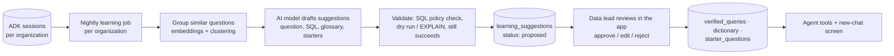

# QueryMuse — MVP extension roadmap

**Status:** planned, not scheduled (2026-11-22). Builds on the MVP
([one_data_navigator_mvp_dev_plan.md](./one_data_navigator_mvp_dev_plan.md)).

**Why not CopilotKit "Rich Threads"?** Rich Threads (CopilotKit Intelligence, a paid hosted or self-hosted-on-
Kubernetes service) records every thread's AG-UI events so the same user can reconnect/replay, and its *Automatic
Learning* mines threads to propose reusable skills. The ideas are good, but it copies every conversation (questions
and result samples) to a third-party store — a data-handling review for clients like Cotality — and self-hosting
needs Kubernetes. We already store conversations in our own Postgres (ADK sessions), so we build the two valuable
parts ourselves, tenant-isolated, with the AI model we already use. Sharing between users is covered separately
([chat_session_share_plan.md](./chat_session_share_plan.md)).

| # | Item | Effort | Value |
|---|---|---|---|
| 1 | Learning from usage: verified queries, glossary suggestions, starter questions | ≈ 2–3 days (first version) | More accurate and faster answers over time; data never leaves our system |
| 2 | Resume a live answer after refresh / on another tab | ≈ 1–2 days | No lost or "stuck" answers when the page reloads mid-run |

---

## 1. Learning from usage

Spot repeated questions and query patterns in each organization's own conversations and turn them into reusable
**skills** that data leads approve.

### What it suggests

| Suggestion | Example | Once approved |
|---|---|---|
| **Verified query** — a question (and paraphrases) with the SQL that answered it, its connection and tables | "Businesses by status in a city" → parameterized SQL on `public.businesses` | The agent finds it by meaning (embedding search) and reuses/adapts the SQL instead of exploring schemas again; answers show "Based on a verified query" |
| **Glossary entry / column description** | "Gold maturity = `maturity = 'gold'`"; "`published` = has a live web presence" | Added to the curated data dictionary (`platform/catalog/dictionary.py`, already `draft/approved/deprecated`), so the agent and the Explorer use it |
| **Suggested starter questions** | The 5–8 most useful questions people ask about this organization's data | Shown on a new conversation and to new users |

### How it works



- **Job:** runs nightly in the worker (or a scheduled container), one organization at a time, under that
  organization's RLS (`tenant_transaction`). Reads only successful turns (question → `run_sql`/`query_workspace` SQL
  → answer the user didn't follow with a correction like "that's wrong"). Skips personal connections unless the
  owner opts in.
- **Grouping:** embeddings of the questions (pgvector, already in Postgres) + simple clustering; a group needs ≥ 3
  questions from ≥ 2 people (configurable) before it's proposed.
- **Drafting:** the organization's AI model (platform trial budget or their own key) writes the canonical question,
  paraphrases, a parameterized SQL (e.g. `:city`), a one-line description, and glossary candidates from repeated
  filters/columns.
- **Validation:** every SQL goes through the existing SQL policy (read-only, allowlists) and a dry run / `EXPLAIN`
  (bytes estimate for BigQuery); failing drafts are dropped.
- **Review UI:** a **Learning** section (Organization tab, data leads and admins): proposed items with the source
  questions (anonymized counts, "asked 14 times by 5 people"), the SQL, a *Try it* button, and Approve / Edit /
  Reject. Approved verified queries can be deprecated later.
- **Agent use:** a new tool `find_verified_query(question)` (vector search over approved items for the user's
  connections) called before schema exploration; the instruction says to prefer an approved query and adapt its
  parameters. Starter questions appear on the empty chat screen.

### Data model (sketch)

```sql
CREATE TABLE learning_suggestions (
  id uuid PRIMARY KEY, tenant_id uuid NOT NULL, kind text CHECK (kind IN ('verified_query','glossary','starter')),
  payload jsonb NOT NULL,            -- question, paraphrases, sql, params, connection_id, tables / term, definition
  evidence jsonb NOT NULL,           -- counts, sample (session, turn) refs — no other users' names to reviewers
  status text NOT NULL DEFAULT 'proposed' CHECK (status IN ('proposed','approved','rejected')),
  reviewed_by uuid, reviewed_at timestamptz, created_at timestamptz DEFAULT now());
CREATE TABLE verified_queries (
  id uuid PRIMARY KEY, tenant_id uuid NOT NULL, connection_id uuid NOT NULL, question text NOT NULL,
  paraphrases text[] NOT NULL DEFAULT '{}', sql_text text NOT NULL, params jsonb NOT NULL DEFAULT '[]',
  description text, embedding vector(768), status text NOT NULL DEFAULT 'approved', approved_by uuid,
  uses int NOT NULL DEFAULT 0, last_used_at timestamptz, created_at timestamptz DEFAULT now());
CREATE TABLE starter_questions (id uuid PRIMARY KEY, tenant_id uuid NOT NULL, question text NOT NULL,
  position int NOT NULL, created_at timestamptz DEFAULT now());
-- All three: ENABLE + FORCE RLS (tenant isolation), grants to odn_app (tests/db/test_rls.py guard).
```

### Safety and privacy

- Strictly per organization; nothing is shared across tenants or sent outside our stack (beyond the AI model the
  organization already uses for chat).
- Reviewers see aggregated evidence ("asked 14 times"), not who asked or their full conversations.
- Verified queries run with the **asking user's** connection and permissions, never the original author's.
- Admin switch: *Learn from conversations* on/off per organization (default on, or off for regulated clients).
- Activity log: `learning.approved`, `learning.rejected`, `learning.settings_saved`.

### Phases

| Phase | Scope | Effort |
|---|---|---|
| 1a | Job: read sessions, group questions, draft + validate verified queries; `learning_suggestions`; review list with approve/reject | ≈ 1.5 days |
| 1b | `find_verified_query` tool + instruction; "Based on a verified query" note in answers; usage counts | ≈ 0.5–1 day |
| 1c | Glossary/column-description suggestions into the dictionary; starter questions on the new-chat screen | ≈ 0.5–1 day |
| Later | Edit-in-place SQL with parameters, quality metrics (answer time, retries before/after), suggestions from failed or corrected answers ("what users couldn't get") | — |

Measure: % of questions answered via a verified query, median answer time and warehouse bytes scanned
before/after, approval rate of suggestions.

---

## 2. Resume a live answer

**Today:** if the page is refreshed or the user switches tab/device while the agent is answering, the chat reloads
from the saved session and shows the answer only once the run finishes; meanwhile it looks stuck. (Paused SQL
approvals already resume.)

**Plan:** keep a short, per-run log of AG-UI events and let the browser reconnect to it.

- The agent tees each run's AG-UI events into a run log keyed by (user, thread, run): in Postgres (an
  `agent_run_events` table, rows deleted when the run ends + a few minutes) or an in-memory ring buffer per run
  (single VM; lost on restart, acceptable).
- New endpoint `GET /agent/runs/{thread_id}/live?after=<event seq>` (server-sent events): replays the events so far,
  then streams new ones until `RUN_FINISHED`/`RUN_ERROR`. Same bearer-token check as the agent (owner only).
- Frontend: on load, `HistoryHydrator` asks whether the thread has an active run; if so it shows "Answering…",
  attaches to the live stream (steps, inline chart, text appear as they arrive), and then reloads the session.
  The Chats tab marks threads with an active run.
- Edge cases: two tabs on the same thread both attach read-only; only one can send while a run is active (the
  composer says "Answer in progress"); stop/cancel from any tab.

| Phase | Scope | Effort |
|---|---|---|
| 2a | Run log + live endpoint in the agent; tests (replay order, owner-only, cleanup) | ≈ 1 day |
| 2b | Frontend attach on load, "Answer in progress" state, Chats indicator | ≈ 0.5–1 day |
